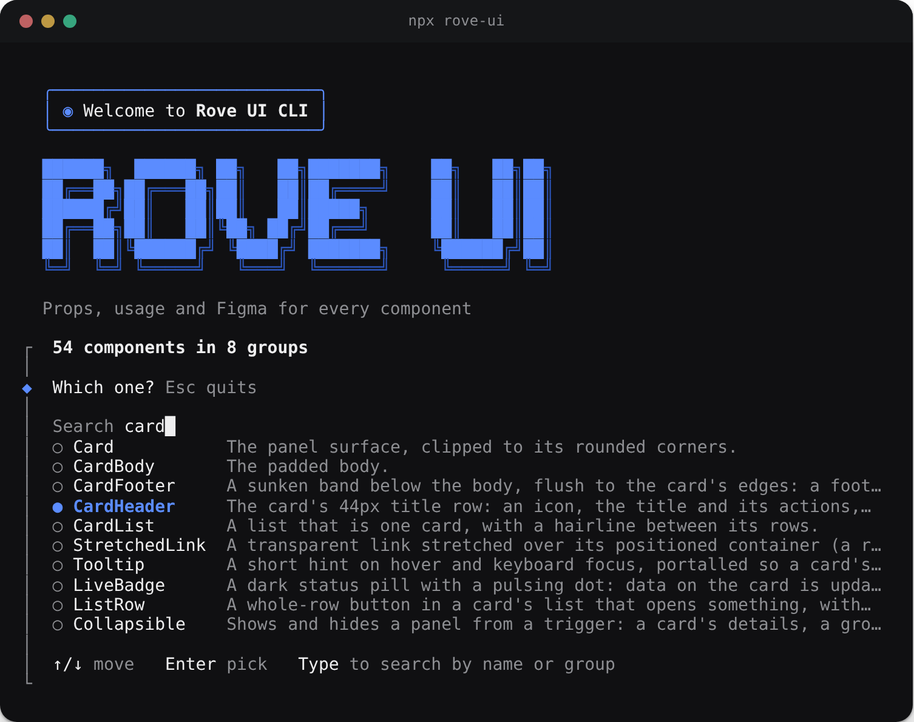

# Contributing to Rove

How to set up, run, check and build Rove. What the app is and how it fits
together are in the [README](README.md); the rules every change follows, and
what to run for each kind of change, are in [AGENTS.md](AGENTS.md).

Token changes start in Figma: [packages/tokens/CONTRIBUTING.md](packages/tokens/CONTRIBUTING.md)
walks through them.

## Prerequisites

[Node.js](https://nodejs.org) 24, as `.nvmrc` says (`nvm use`),
[pnpm](https://pnpm.io) at the version `packageManager` in `package.json` names
(`corepack enable pnpm` fetches it) and [Rust](https://rustup.rs), plus
Tauri's system libraries:

- **Linux** (Debian, Ubuntu):
  ```bash
  sudo apt install -y build-essential libwebkit2gtk-4.1-dev libgtk-3-dev \
    librsvg2-dev libayatana-appindicator3-dev
  ```
- **macOS:** the Xcode command line tools, `xcode-select --install`.
- **Windows:** the [Microsoft C++ Build Tools](https://visualstudio.microsoft.com/visual-cpp-build-tools/)
  ("Desktop development with C++"). WebView2 already ships with Windows 10
  and 11.

## Run

```bash
pnpm install                 # also turns on the git hooks (scripts/hooks/git)
pnpm exec playwright install chromium   # once, for the story tests
pnpm tauri:dev               # run the desktop app (hot-reloads the UI)
pnpm dev                     # UI only, in a browser, against the mock bridge
pnpm storybook               # the UI library's components, at localhost:6006
pnpm screenshots             # refresh docs/screenshots: every screen, at window size
pnpm format                  # lay out the code with Prettier
pnpm gen                     # rewrite the *.gen.* files after a library or theme change
pnpm rove-ui                 # find a library component: pick one, or list, show, search (--md for agents)
cargo run -p rove-core --example scan   # print a live LAN scan
```

## Workspaces

The repository is three pnpm workspaces: the app in `apps/rove`, the
component library in `packages/ui`, which the app imports as
`@swiftsolve/rove-ui` straight from its source, and the design tokens in
`packages/tokens`, `@swiftsolve/rove-tokens`, which the library imports from
their build. A library or token change shows in the app with no release
between them; the tokens are still published to npm for the sites that
install them.

Run the commands above from the root. Its typecheck, tests, build and ESLint
go through [Turborepo](https://turborepo.com), which runs each workspace's own
script and replays a result whose files haven't changed; CI keeps that cache
between runs. ESLint is cached as a whole, never per file, as its typed rules
read the types of the files a file imports. Prettier keeps its own per-file
cache, and `scripts/checks/` always runs, since one asks the Figma file.

## Check a change

```bash
pnpm check                   # typecheck, lint, the repo's checks and every Vitest test
pnpm test                    # just the UI's unit, DOM and story tests
pnpm a11y                    # axe on every screen and dialog, both themes
cargo test -p rove-core      # the service layer's tests
cargo clippy --workspace --all-targets -- -D warnings   # the Rust lints (Cargo.toml)
cargo fmt --all              # the Rust layout (rustfmt.toml)
```

Each stage runs part of this on its own:

| Stage | Runs |
| --- | --- |
| Each edit (Claude Code, `.claude/settings.json`) | Prettier and ESLint on the file. Refuses a hook skipped, a force push, `git reset --hard`, and a direct edit to a `*.gen.*` file (run `pnpm gen`) |
| Each commit (`scripts/hooks/git/`, on after `pnpm install`) | ESLint and Prettier on the staged files; Rust fmt and tests when Rust is staged. `commit-msg` refuses an agent attribution line |
| Each push and pull request (CI) | `pnpm check` (`test.yml`); `rove-core`'s Rust fmt, clippy and tests on Linux (`test.yml`); Chromatic's visual snapshots |
| A Rove release tag, `v*` (CI) | Rust fmt, clippy, tests and the app build on three OSes (`build.yml`), beside the release bundles (`release.yml`); `build.yml` also runs on demand from Actions |
| A tokens release tag, `tokens-v*` (CI) | The tokens' build, typecheck and tests (the Figma plugin test, contrast, the DESIGN.md format) and `DESIGN.md` committed as built (`publish-tokens.yml`); it publishes to npm only if they pass |

What to run yourself for each kind of change is in
[AGENTS.md](AGENTS.md#check-your-work).

## Release build

```bash
pnpm tauri:build      # .deb ~5 MB, AppImage, dmg (macOS), nsis and msi (Windows)
```

## Release

A `v*` tag builds Rove on all three OSes and publishes a GitHub release
(`release.yml`). Each installer is signed with the updater key, and
`latest.json` lists them, so every running copy of Rove finds the release
within a few hours, or at its next launch, and offers to install it.

1. Set the new version in `apps/rove/package.json`,
   `apps/rove/src-tauri/tauri.conf.json` and `apps/rove/src-tauri/Cargo.toml`,
   run `cargo check` to update `Cargo.lock`, and commit.
2. Tag it with an annotated tag whose message is the release notes, one
   change per line. The update dialog lists them under "What's new":
   ```bash
   git tag -a v1.2.3 -m "- Devices: names stay put across rescans
   - Speed test: a steadier upload reading"
   ```
3. Push the tag: `git push origin v1.2.3`.

## Design system

Tokens are designed in the [Rove Design System](https://www.figma.com/design/NoICIoyhWNOya9tOnNfEhH/Rove-Design-System)
in Figma and exported, one way, into [packages/tokens](packages/tokens/README.md),
which checks that Figma and the package agree. Components start in
`packages/ui/`, and Figma mirrors them. Without Figma, browse the
[Tokens Storybook](https://nabilr.com/rove/storybook/tokens/) and the
[Components Storybook](https://nabilr.com/rove/storybook/).

In a terminal, `pnpm rove-ui` looks a component up: `pick` to find one by
typing, `show <Name>` for its props, usage guide and Figma component, and
`--md` for an agent.

<p align="center">
  
</p>

## Troubleshooting on Linux

- **The app aborts at startup with a GLib or GTK error** when launched from
  VS Code installed as a snap. Its terminals pass on the snap's library and
  schema paths (`env | grep SNAP` shows them). Install VS Code from
  [Microsoft's `.deb`](https://code.visualstudio.com/docs/setup/linux) instead.
- **"Too many open files"** from the dev server's file watcher: the inotify
  instance limit defaults to 128. Raise it:
  ```bash
  echo fs.inotify.max_user_instances=1024 | sudo tee /etc/sysctl.d/60-inotify-instances.conf
  sudo sysctl --system
  ```
