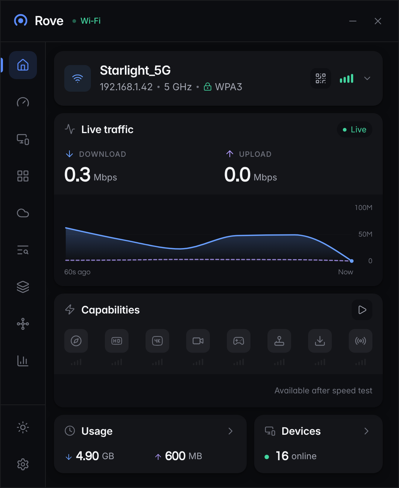
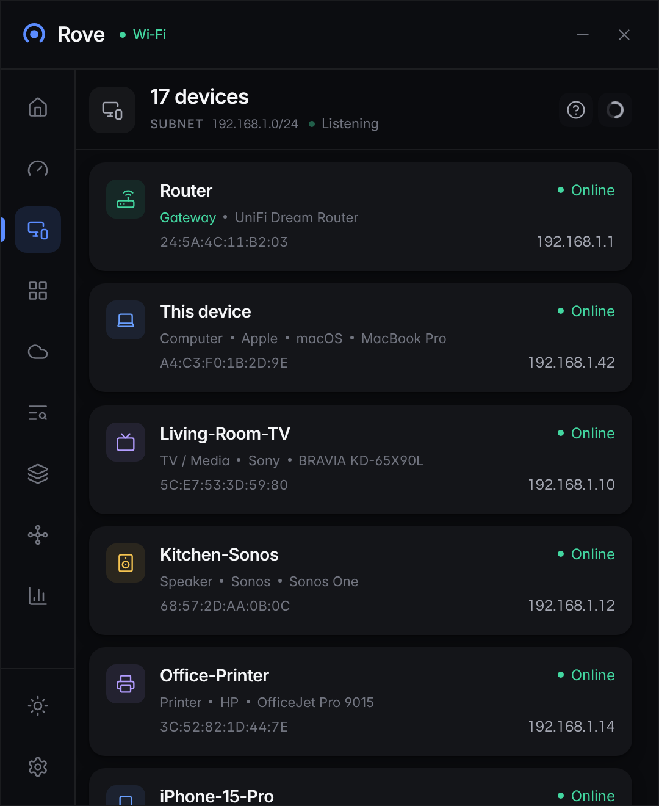
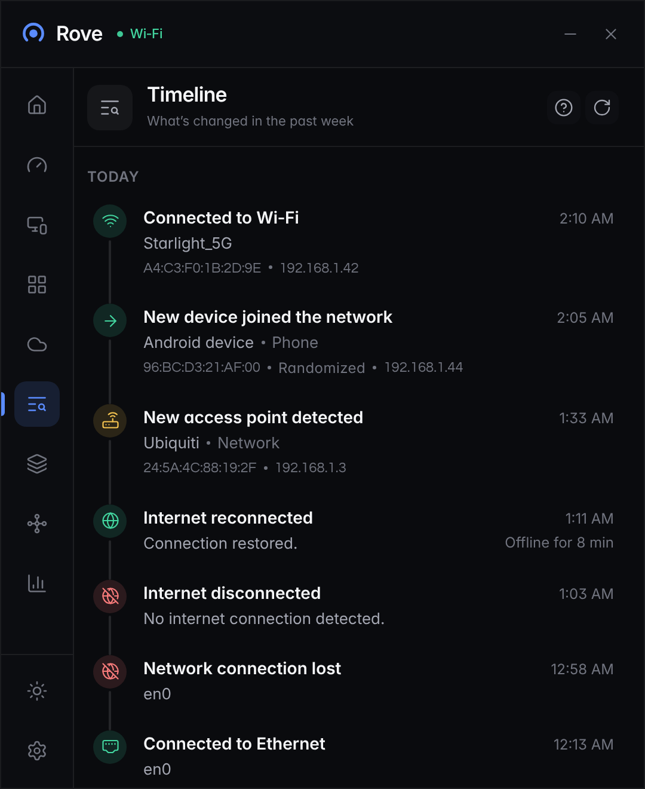

<div align="center">


# Rove

**A fast, minimal desktop network monitor.**

Live traffic, speed tests, LAN devices, per-app hosts and data usage, read
straight from your operating system.

<p>
  
  
  
  
  
</p>

**[Try it in your browser](https://rove.swiftsolve.net)**&emsp;**[Download](https://github.com/swiftsolve/rove/releases/latest)**



</div>

## Features

- **Live traffic.** Download and upload, second by second, on the interface
  your traffic really uses.
- **Speed test.** Download, upload, latency and jitter, then whether the
  connection can handle 4K streaming, video calls, cloud gaming and more.
- **Devices.** Everything on your LAN, named and labelled by kind (phone,
  printer, TV, router), including devices that ignore pings.
- **Apps and hosts.** How much each app downloads and uploads, and the remote
  hosts it talks to, with countries looked up offline.
- **Timeline.** What changed in the past week: networks joined, devices that
  appeared, and internet drops with how long they lasted.
- **Services.** The sites and servers you care about, with their latency and
  an up/down history.
- **Usage.** Data used per day, kept across restarts.
- **Diagnostics.** Router latency, jitter and packet loss, and the DNS
  servers in use.

<p align="center">
  
  
  
  
</p>

The readings come from the OS's own tools and counters (the routing table,
the neighbor table, the kernel's byte counters), not from a cloud service.
Where each one comes from, what it can miss, and the tool used on each OS are in
[What Rove Measures, and How](docs/what-rove-measures.md).

## Install

Download the latest build from
[Releases](https://github.com/swiftsolve/rove/releases/latest):

| OS | File |
|---|---|
| Linux | `.deb` or `.AppImage` |
| macOS | `.dmg` (Apple silicon and Intel) |
| Windows | `.msi` or `-setup.exe` |

Rove updates itself from there. To build it yourself, see
[Development](#development).

On macOS, Rove asks for Location Services once at startup: macOS hides the
Wi-Fi network name behind it. Without it, everything but the name still shows.

## How it works

Rove is two programs talking over a thin, typed bridge:

<div align="center">
  
</div>

- **Request/response.** Each thing the UI needs is one Tauri *command*
  (`get_network_info`, `get_devices`, `run_speed_test`, …): a thin wrapper in
  `src-tauri/src/commands.rs` around a pure-Rust service in
  `crates/rove-core`.
- **Push.** Five *events* flow the other way, for data that's continuous or
  starts outside the app: `live-throughput`, `speed-test-progress`,
  `internet-status`, `services-timeline` and `network-changed`. The last
  carries no payload: it tells the UI to refetch within ~1 s of a cable pull
  or Wi-Fi join, instead of waiting for the 15 s poll.
- **The contract.** TypeScript types in `src/types/` define every payload, and
  the Rust structs mirror them field for field. The UI never knows it's talking
  to Rust: a browser mock (`src/bridge/mock-network-api.ts`) implements the same
  interface, which is why `npm run dev` runs in a plain browser.

The bridge, pull vs push, and what an `invoke` is on the wire are in
[How Rove Is Put Together](docs/architecture.md).

## Security model

Tauri v2 is deny-by-default: the webview can only call what
`src-tauri/capabilities/default.json` grants (our commands, event listening,
and the frameless-window controls). There is no Node runtime in the UI process
and the backend is memory-safe Rust.

The Hosts view knows which remote hosts each app talks to, a list that is
browsing history in all but name. *That list* never leaves your machine: country
flags are resolved against an IP-to-country table bundled in the binary
(`util/geoip.rs`), not by asking a geolocation API about each peer.

Two things do leave, neither of them a peer address:

- **Your own WAN identity**, when the Connection tab asks: your public IP
  (api.ipify.org). Your ISP, ASN, and country are then resolved from that IP
  against bundled tables (`util/geoip.rs`), no request. A best-effort call to
  ipwho.is only *enriches* the card with your city and ISP website when it isn't
  rate-limited; the card stays populated without it. Every request here is about
  your own address.
- **Brand icons**, via Google's favicon service (`ServiceIcon.tsx`). This sends a
  *domain*: `firefox.com` for Firefox, plus the services you've chosen to
  monitor. Never a discovered peer, and never a hostname the Hosts view
  reverse-resolved. Apps it doesn't recognise fall back to a letter monogram and
  ask nothing.

All of it is keyless: Rove ships no API credentials.

## Bundled data

| Table | Source | License | Refresh |
|---|---|---|---|
| MAC OUI → vendor (`data/oui.tsv`) | [IEEE Registration Authority](https://standards-oui.ieee.org/) | Public registry | `cargo run -p rove-core --example gen_oui` |
| IP → country (`data/dbip-country-lite.mmdb.gz`) | [IP Geolocation by DB-IP](https://db-ip.com) | [CC BY 4.0](https://creativecommons.org/licenses/by/4.0/) | `cargo run -p rove-core --example gen_geoip` |
| IP → ASN (`data/dbip-asn-lite.mmdb.gz`) | [IP Geolocation by DB-IP](https://db-ip.com) | [CC BY 4.0](https://creativecommons.org/licenses/by/4.0/) | `cargo run -p rove-core --example gen_geoip` |
| Hosting/VPN ASNs (`data/hosting-asns.txt`) | [brianhama/bad-asn-list](https://github.com/brianhama/bad-asn-list) | [MIT](https://opensource.org/licenses/MIT) | `cargo run -p rove-core --example gen_hosting_asns` |

The OUI and IP sources are chosen to be freely redistributable in a shipped binary: IEEE over
Wireshark's GPL-2.0 `manuf`, and DB-IP over MaxMind's GeoLite2, whose EULA
requires destroying superseded copies within 30 days of each twice-weekly
release, a term a binary already on users' machines cannot honour.

The Hosts view's country flags are drawn with the **Twemoji Country Flags**
font (`src/assets/fonts/TwemojiCountryFlags.woff2`), because Windows ships no
flag emoji of its own. The glyph artwork is [Twemoji](https://github.com/twitter/twemoji),
[CC BY 4.0](https://creativecommons.org/licenses/by/4.0/).

## Development

### Prerequisites

[Node.js](https://nodejs.org) 20.19 or later (CI uses 22, as `.nvmrc` says) and [Rust](https://rustup.rs), plus
Tauri's system libraries:

- **Linux** (Debian, Ubuntu):
  ```bash
  sudo apt install -y build-essential libwebkit2gtk-4.1-dev libgtk-3-dev \
    librsvg2-dev libayatana-appindicator3-dev
  ```
- **macOS:** the Xcode command line tools, `xcode-select --install`.
- **Windows:** the [Microsoft C++ Build Tools](https://visualstudio.microsoft.com/visual-cpp-build-tools/)
  ("Desktop development with C++"). WebView2 already ships with Windows 10
  and 11.

### Run

```bash
npm install                  # also turns on the git hooks (scripts/hooks/git)
npx playwright install chromium   # once, for the story tests
npm run tauri:dev            # run the desktop app (hot-reloads the UI)
npm run dev                  # UI only, in a browser, against the mock bridge
npm run storybook            # the UI library's components, at localhost:6006
npm run screenshots          # refresh docs/screenshots: every screen, at window size
npm run format               # lay out the code with Prettier
npm run gen                  # rewrite the *.gen.* files after a library or theme change
cargo run -p rove-core --example scan   # print a live LAN scan
```

### Check a change

```bash
npm run check                # typecheck, lint, the repo's checks and every Vitest test
npm test                     # just the UI's unit, DOM and story tests
npm run a11y                 # axe on every screen and dialog, both themes
cargo test -p rove-core      # the service layer's tests
cargo clippy --workspace --all-targets -- -D warnings   # the Rust lints (Cargo.toml)
cargo fmt --all              # the Rust layout (rustfmt.toml)
```

Each stage runs part of this on its own:

| Stage | Runs |
| --- | --- |
| Each edit (Claude Code, `.claude/settings.json`) | Prettier and ESLint on the file. Refuses a hook skipped, a force push, `git reset --hard`, and a direct edit to a `*.gen.*` file (run `npm run gen`) |
| Each commit (`scripts/hooks/git/`, on after `npm install`) | ESLint and Prettier on the staged files; Rust fmt and tests when Rust is staged. `commit-msg` refuses an agent attribution line |
| Each push and pull request (CI) | `npm run check` (`test.yml`); `rove-core`'s Rust fmt, clippy and tests on Linux (`test.yml`); Chromatic's visual snapshots |
| A Rove release tag, `v*` (CI) | Rust fmt, clippy, tests and the app build on three OSes (`build.yml`), beside the release bundles (`release.yml`); `build.yml` also runs on demand from Actions |
| A rove-tokens release (its CI) | Its `npm run check` (build, lint, contrast, the DESIGN.md format, the Figma plugin test) and `DESIGN.md` committed as built; it publishes only if they pass |

What to run yourself for each kind of change is in
[AGENTS.md](AGENTS.md#check-your-work).

### Release build

```bash
npm run tauri:build   # .deb ~5 MB, AppImage, dmg (macOS), nsis and msi (Windows)
```

### Where things are

```
src/                React UI: app/ (the shell), features/ (a folder per screen),
                    ui/ (the component library), types/ and bridge/ (the contract)
crates/rove-core/   every platform service, in pure Rust, plus the bundled data
src-tauri/          the thin Tauri shell: commands, events, capabilities
scripts/            checks, generators, git hooks, screenshots, the a11y audit
docs/               the deeper dives, diagrams and screenshots
```

Folder by folder: [Where everything lives](docs/architecture.md#where-everything-lives).

The UI's conventions (state from context and TanStack Query, Tailwind built
only from the design tokens, library components before new markup) are in
[src/README.md](src/README.md).

### Design system

Tokens are designed in the [Rove Design System](https://www.figma.com/design/NoICIoyhWNOya9tOnNfEhH/Rove-Design-System)
in Figma and released from [rove-tokens](https://github.com/swiftsolve/rove-tokens),
which exports them from Figma, one way, and checks that Figma and the package
agree. Components start in `src/ui`, and Figma mirrors them. Without Figma,
browse the [Tokens Storybook](https://rove.swiftsolve.net/storybook/tokens/)
and the [Components Storybook](https://rove.swiftsolve.net/storybook/).

### Troubleshooting on Linux

- **The app aborts at startup with a GLib or GTK error** when launched from
  VS Code installed as a snap. Its terminals pass on the snap's library and
  schema paths (`env | grep SNAP` shows them). Install VS Code from
  [Microsoft's `.deb`](https://code.visualstudio.com/docs/setup/linux) instead.
- **"Too many open files"** from the dev server's file watcher: the inotify
  instance limit defaults to 128. Raise it:
  ```bash
  echo fs.inotify.max_user_instances=1024 | sudo tee /etc/sysctl.d/60-inotify-instances.conf
  sudo sysctl --system
  ```

## Read more

- [What Rove Measures, and How](docs/what-rove-measures.md): each feature's
  source of truth, what it can miss, and the tool on each OS.
- [How Rove Is Put Together](docs/architecture.md): the bridge, pull vs push,
  and what an `invoke` is on the wire.
- [How Rove Captures Network Data (per OS)](docs/networking/data-capture.md)
- [How Rove Discovers & Identifies LAN Devices](docs/networking/device-discovery.md)
- [The Networking Protocols Behind Rove's Device Discovery](docs/networking/protocols.md)
- [Rove frontend](src/README.md) and [Rove UI library](src/ui/README.md): how
  the UI and its components are built.
- [Learning Rust & Tauri through Rove](docs/learning/rust-and-tauri/README.md)
- [Why "Rove"?](docs/why-rove.md)

All of them, grouped: [docs/](docs/README.md).

## License

[MIT](LICENSE). The bundled data and the flag font keep their own licences,
listed in [Bundled data](#bundled-data).
