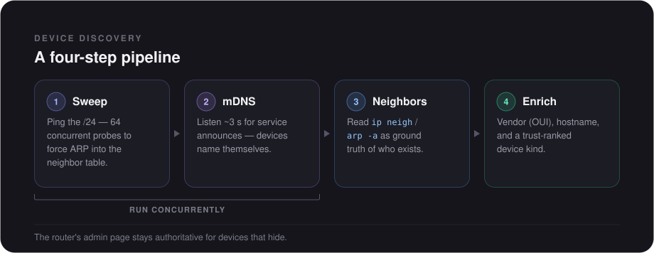

<div align="center">


# Rove

**A fast, minimal desktop network monitor.**

Live traffic · speed tests · LAN device discovery · connection diagnostics · data-usage tracking

<p>
  
  
  
  
</p>

</div>

---

## How it works

Rove is two programs talking over a thin, typed bridge:

<div align="center">
  
</div>

- **Request/response.** Each UI data need is one Tauri *command* (`get_network_info`,
  `get_devices`, `run_speed_test`, …), a thin wrapper in `src-tauri/src/commands.rs`
  — registered in `lib.rs` — around a pure-Rust service in `crates/rove-core`.
- **Push** — five *events* flow the other way, each because it's continuous,
  arrives mid-operation, or is triggered from outside the app: `live-throughput`
  (1 Hz while subscribed), `speed-test-progress`, `internet-status` and
  `services-timeline` (from the always-on background heartbeats), and
  `network-changed` (the backend watches `ip monitor route` and nudges the UI
  within ~1 s of a cable pull or Wi-Fi join, so state never waits on the 15 s
  poll). That last one carries no payload at all — it just makes the pull that
  already exists happen now.
- **The contract** — TypeScript types in `src/types/` define every payload; the
  Rust structs in `crates/rove-core/src/types.rs` mirror them field-for-field
  (serde renames everything to camelCase on the wire). The UI never knows it's
  talking to Rust: `src/bridge/tauriNetworkApi.ts` implements the same
  `window.networkAPI` interface that a browser mock (`src/dev/`) also implements,
  which is why `npm run dev` works in a plain browser for UI work.

> **Deeper dives**
> - [How Rove Is Put Together](docs/architecture.md) — the swap seam, pull vs
>   push, and what an `invoke` is on the wire.
> - [Learning Rust & Tauri through Rove](docs/learning-rust-and-tauri.md) — the
>   same boundary from the language side.
> - [How Rove Captures Network Data (per OS)](docs/networking-data-capture.md)
> - [How Rove Discovers & Identifies LAN Devices](docs/device-discovery.md)
> - [The Networking Protocols Behind Rove's Device Discovery](docs/networking-protocols.md)
> - [Why "Rove"?](docs/why-rove.md)

### What each feature actually measures

**Connection card / network info.** The kernel routing table is the source of
truth: `ip route show default` names the interface your traffic really uses
(so LAN↔Wi-Fi switches are always right), then per-medium tools fill in the
detail: `iw`/`nmcli` for SSID, band, channel, signal; `ethtool`/sysfs for link
speed and duplex. DNS comes from `resolv.conf`.

**Live traffic.** A 1 Hz sampler reads the kernel's cumulative per-interface
byte counters (via `sysinfo`), converts deltas to Mbps, smooths them with an
exponential moving average, and emits an event. Virtual interfaces (docker,
veth, vpn…) are excluded.

**Devices.** A four-step pipeline (`crates/rove-core/src/devices/`):

<div align="center">
  
</div>

1. *Sweep* — ping every host in your /24 (64 concurrent probes). The point is
   not the ICMP reply but the ARP exchange it forces: idle devices enter the
   kernel neighbor table even if they block ping.
2. *mDNS*: concurrently, listen ~3 s for service announcements (`_googlecast`,
   `_ipp`, `_hap`, `_raop`, …). Devices literally say what they are, often with
   a friendly name and hardware model.
3. *Neighbor table*: `ip neigh` (or `arp -a`) is then read as the ground truth
   of who exists.
4. *Enrich & classify*: each host gets a vendor (MAC OUI table), a hostname
   (reverse DNS/mDNS, junk names filtered), and a best-effort kind. Signals are
   ranked by trust: role flags → mDNS service type → mDNS hardware model →
   hostname patterns → vendor patterns → weak mDNS hints → "unknown".
   A device that blocks ping *and* announces nothing can still hide; the
   router's admin page stays authoritative.

**Speed test.** Saturates the link ~6 s per direction: parallel HTTPS streams
from public test endpoints (download) and random-payload POSTs (upload), then
10 pings to 1.1.1.1 for latency/jitter/loss. Progress streams as events; a
cancel command aborts between and within phases (streams poll a shared flag).
Results feed the capability ratings (can this connection do 4K, cloud gaming…)
against per-activity thresholds. Fair warning: at multi-gigabit rates one test
moves 1–2 GB. That's inherent to how throughput measurement works.

**Data usage.** Every 30 s the backend accumulates counter deltas into per-day
buckets persisted in the app-data dir (survives restarts; counters themselves
reset at boot, which the delta logic handles). The "since boot" totals shown in
the UI are read straight from `/sys/class/net/*/statistics` at query time:
kernel truth, no bookkeeping.

**Diagnostics.** Pings your default gateway (latency / jitter / packet loss)
and lists the DNS servers in use.

### Security model

Tauri v2 is deny-by-default: the webview can only call what
`src-tauri/capabilities/default.json` grants (our commands, event listening,
and the frameless-window controls). There is no Node runtime in the UI process
and the backend is memory-safe Rust.

The Hosts view knows which remote hosts each app talks to — a list that is
browsing history in all but name. *That list* never leaves your machine: country
flags are resolved against an IP-to-country table bundled in the binary
(`geoip.rs`), not by asking a geolocation API about each peer.

Two things do leave, neither of them a peer address:

- **Your own WAN identity**, when the Connection tab asks: your public IP
  (api.ipify.org). Your ISP, ASN, and country are then resolved from that IP
  against bundled tables (`geoip.rs`) — no request. A best-effort call to
  ipwho.is only *enriches* the card with your city and ISP website when it isn't
  rate-limited; the card stays populated without it. Every request here is about
  your own address.
- **Brand icons**, via Google's favicon service (`ServiceIcon.tsx`). This sends a
  *domain*: `firefox.com` for Firefox, plus the services you've chosen to
  monitor. Never a discovered peer, and never a hostname the Hosts view
  reverse-resolved. Apps it doesn't recognise fall back to a letter monogram and
  ask nothing.

All of it is keyless — Rove ships no API credentials.

### Bundled data

| Table | Source | License | Refresh |
|---|---|---|---|
| MAC OUI → vendor (`data/oui.tsv`) | [IEEE Registration Authority](https://standards-oui.ieee.org/) | Public registry | `cargo run -p rove-core --example gen_oui` |
| IP → country (`data/dbip-country-lite.mmdb.gz`) | [IP Geolocation by DB-IP](https://db-ip.com) | [CC BY 4.0](https://creativecommons.org/licenses/by/4.0/) | `cargo run -p rove-core --example gen_geoip` |
| IP → ASN (`data/dbip-asn-lite.mmdb.gz`) | [IP Geolocation by DB-IP](https://db-ip.com) | [CC BY 4.0](https://creativecommons.org/licenses/by/4.0/) | `cargo run -p rove-core --example gen_geoip` |
| Hosting/VPN ASNs (`data/hosting-asns.txt`) | [brianhama/bad-asn-list](https://github.com/brianhama/bad-asn-list) | [MIT](https://opensource.org/licenses/MIT) | `cargo run -p rove-core --example gen_hosting_asns` |

Both are chosen to be freely redistributable in a shipped binary: IEEE over
Wireshark's GPL-2.0 `manuf`, and DB-IP over MaxMind's GeoLite2, whose EULA
requires destroying superseded copies within 30 days of each twice-weekly
release — a term a binary already on users' machines cannot honour.

The Hosts view's country flags are drawn with the **Twemoji Country Flags**
font (`src/assets/fonts/TwemojiCountryFlags.woff2`), because Windows ships no
flag emoji of its own. The glyph artwork is [Twemoji](https://github.com/twitter/twemoji),
[CC BY 4.0](https://creativecommons.org/licenses/by/4.0/).

## Layout

```
rove/
├── src/                        React UI (Vite)
│   ├── main.tsx                entry: installs the bridge, mounts the app
│   ├── app/                    the shell, laid out like a feature: App.tsx
│   │                           (providers) and AppShell.tsx at the top, then
│   │                           components/ (title bar, nav rail,
│   │                           CurrentScreen), context/ (navigation, theme,
│   │                           network), hooks/ (useNetwork,
│   │                           useInternetStatus, useConnectionStatus, …)
│   │                           and utils/ (incl. the TanStack query client)
│   ├── features/               one folder per area: home, speed,
│   │   │                       capabilities, connection, live-throughput,
│   │   │                       interfaces, devices, events, usage, apps,
│   │   │                       diagnostics, services, settings, about
│   │   └── <area>/             its views (+ their CSS) at the top
│   │       ├── components/     parts of those views, when a view has them
│   │       ├── context/        its own context, if it ever needs one
│   │       ├── hooks/          that area's data and state hooks
│   │       └── utils/          its plain helpers (no React)
│   │                           (capabilities, connection and live-throughput
│   │                           have no view, so their parts sit at the top)
│   ├── components/             shared UI used across features: Section,
│   │                           DataRow, Subpage, Tooltip, Icons, …
│   ├── hooks/                  shared hooks (useBackendQuery is the
│   │                           useQuery shape every data hook builds on)
│   ├── lib/                    shared helpers (format, platform, highlight)
│   ├── types/                  the UI↔backend contract (mirrored in Rust)
│   ├── bridge/                 Tauri implementation of the contract
│   └── dev/                    browser mock bridge (npm run dev without Tauri)
├── crates/rove-core/         all platform services in pure Rust (no Tauri/GTK
│                               deps — compiles and tests anywhere): network_info,
│                               interfaces, devices/, diagnostics, speed, mdns,
│                               live_throughput, data_usage, oui, geoip, shell
│   └── data/                   bundled lookup tables (OUI, IP-to-country)
└── src-tauri/                  thin Tauri shell: one #[tauri::command] per
                                service, events, capabilities, window config
```

### Frontend conventions

**State: context, not prop drilling**

- No component takes a prop only to pass it down. App-wide state comes from
  context, read where it's used: `useNavigation()` (location, `navigate`,
  `back`), `useTheme()`, `useNetwork()` (network info), `useInternetStatus()`
  and `useConnectionStatus()` (the title bar's verdict). Each has its own small
  context, so a reader re-renders only when its value changes. That's why every
  view renders with no props.
- Backend data comes from TanStack Query. Each feature owns its data hook in
  `hooks/` (`useDevices`, `useDataUsage`, …), built on `useQuery` through
  `useBackendQuery`, and the components that show the data call it directly.
  Callers of the same hook share one cache entry, so `DevicesView` and
  `DevicesCard` see the same scan.
- A query key names the data, plus the network for data that belongs to one
  (`['devices', networkKey]` from `useNetworkKey()`), so a new network gets
  fresh results. A query fetches while a screen that shows it is open and polls
  per its hook; the hooks' comments say when and why.
- Props are for a component's own inputs: the item a row shows, a dialog's
  `onClose`. Shared components in `src/components` take only props and never
  read app context.

**Where code goes**

- `app/` and every feature use the same subfolders: `components/`,
  `context/` (providers and their context objects), `hooks/` and `utils/`.
- A custom hook lives in its own file in a `hooks/` folder, never inside a
  component file.
- `src/types` is only the backend contract, mirrored in Rust. A type only the
  UI uses lives next to the code that owns it, such as
  `features/speed/types.ts`.
- Each component's stylesheet sits next to it and has the same name:
  `DevicesCard.tsx` and `DevicesCard.module.css`.

**Styles: CSS Modules plus a small global layer**

- Component styles are CSS Modules (`Foo.module.css`, imported as `styles`).
  The module is the namespace, so class names carry no prefix and are named by
  role: `.row`, `.row-name`. In code they're camelCase: `styles.rowName`.
- Variants go through CVA (class-variance-authority). An element whose classes
  depend on state or a variant gets a recipe at the top of its file:

  ```ts
  const rowVariants = cva(styles.row, {
    variants: {
      isGateway: { true: styles.isGateway },
      kind: { phone: styles.kindPhone, tv: styles.kindTv },
    },
  })
  // <div className={rowVariants({ isGateway, kind: device.kind })}>
  ```

  States are `is-*` classes (`.is-open`); enumerations are
  `<dimension>-<value>` classes (`.level-good`). Data attributes are never
  styling hooks. `cx()` only joins fixed classes, or a recipe's output with a
  `className` prop.
- Buttons are `Button` (`variant`: `primary`, `filled`, `secondary`) and
  `IconButton` (`tone`: `plain`, `primary`, `secondary`, `stop`; `aria-label`
  is required), never hand-written `<button>` classes.
- A stylesheet only styles its own component. To adjust a child, pass it a
  `className` (the child merges it onto its root with `cx`).
- The global layer is plain `.css`, and only it is global: `index.css`,
  `styles/feedback.css` (`error-banner`, `inline-error`), and the primitives in
  `components/` that many views build on (`Section.css`, `ViewHeader.css`,
  `Subpage.css`, `DataRow.css`, `DotSeparator.css`). Inside a module, reach
  them with `:global(.ui-section-body)`. Use a shared keyframe
  as `animation: global(fade-in) …`, or CSS Modules renames it and the
  animation silently stops.
- `npm run lint` also runs `scripts/check-css-modules.mjs`. It fails on a
  `styles.x` that has no matching class, and on a class nothing uses.

## Design

The [Rove Design System](https://www.figma.com/design/NoICIoyhWNOya9tOnNfEhH/Rove-Design-System)
in Figma is the source of truth for tokens and components. The UI consumes its
tokens through the `@swiftsolve/rove-design` package.

## Development

One-time system deps (Linux):

```bash
sudo apt install -y build-essential libwebkit2gtk-4.1-dev libgtk-3-dev \
  librsvg2-dev libayatana-appindicator3-dev
# Rust, if missing: https://rustup.rs
```

Then:

```bash
npm install
npm run tauri:dev            # run the desktop app (hot-reloads the UI)
npm run dev                  # UI only, in a browser, against the mock bridge
npm run screenshots          # refresh docs/screenshots — every screen, at window size
cargo check -p rove-core   # typecheck the service layer alone
cargo run -p rove-core --example scan   # print a live LAN scan
```

> **Dev note (Linux/snap):** if you launch from a snap-packaged terminal (e.g.
> VS Code from snap), unset its library path first or the binary picks up
> snap's glibc and crashes at startup:
> `env -u LD_LIBRARY_PATH -u GTK_PATH npm run tauri:dev`

## Release build

```bash
npm run tauri:build   # .deb ~5 MB, AppImage, dmg (macOS), nsis (Windows)
```

## Platform support

All services run on Linux, macOS and Windows. Each looks for the native tool
for the job and degrades gracefully (missing values render as “—”):

| | Linux | macOS | Windows |
|---|---|---|---|
| Default route / interface | `ip route` | `route -n get` | `Get-NetRoute` |
| Wi-Fi details | `nmcli`, `iw` | CoreWLAN, `system_profiler` | `netsh wlan` |
| Link speed | `ethtool`, sysfs | CoreWLAN (Wi-Fi) | `Get-NetAdapter` |
| DNS servers | `resolv.conf` | `resolv.conf` | `Get-DnsClientServerAddress` |
| Neighbor table | `ip neigh` | `arp -a` | `arp -a` |
| Reverse hostnames | `getent` | `dscacheutil` | `System.Net.Dns` |
| Interface state | sysfs | `ifconfig` | `Get-NetAdapter` |
| mDNS, sweep, speed test, throughput, usage | pure Rust everywhere | ✓ | ✓ |

Platform branches are runtime `cfg!()` checks, so every path typechecks on
every OS; CI (`.github/workflows/build.yml`) builds all three bundles. The
instant network-change monitor (`ip monitor route`) is Linux-only; macOS and
Windows fall back to the 15 s poll.

On macOS 14.4+ the private `airport` tool was gutted (it now only prints a
deprecation notice), so Rove reads Wi-Fi in-process via CoreWLAN — including the
link-speed / transmit rate, which the shell tools no longer expose. The SSID
sits behind Location Services, so Rove asks for that permission once at startup;
without it the network name shows as “—” while everything else still resolves.
