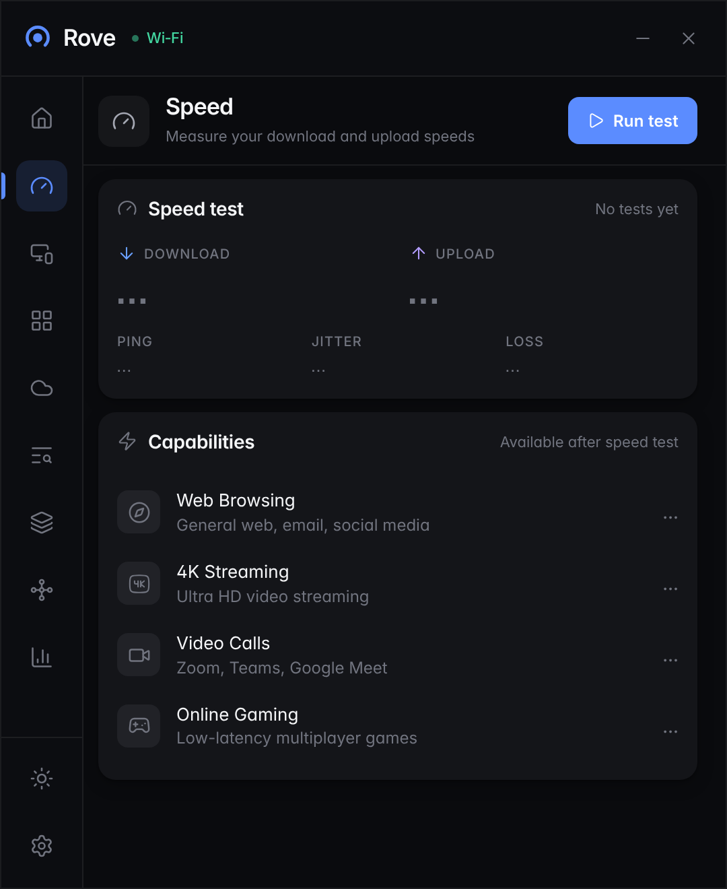
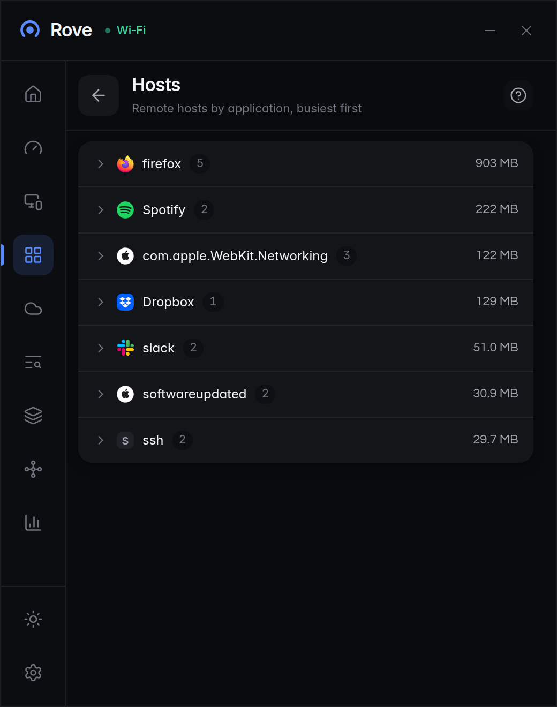
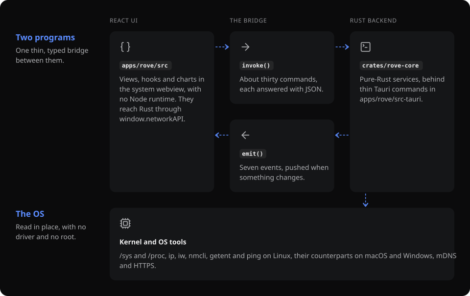
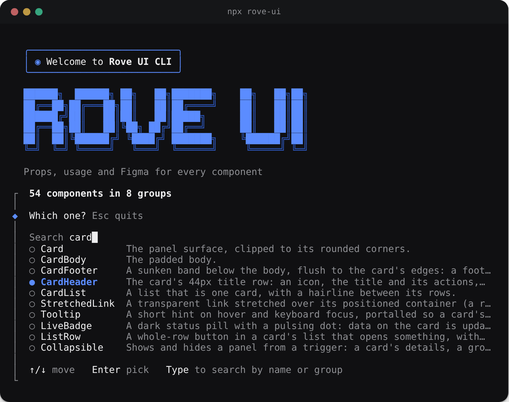

<div align="center">


# Rove

A fast, minimal desktop network monitor,<br>
read straight from your operating system.

[](https://github.com/swiftsolve/rove/releases/latest)
[](https://github.com/swiftsolve/rove/actions/workflows/test.yml)
[](https://v2.tauri.app)
[](#install)
[](LICENSE)

**[Try it in your browser](https://nabilr.com/rove)** &nbsp;·&nbsp;
**[Download](https://github.com/swiftsolve/rove/releases/latest)** &nbsp;·&nbsp;
**[Components Storybook](https://nabilr.com/rove/storybook/)** &nbsp;·&nbsp;
**[Figma file](https://www.figma.com/design/NoICIoyhWNOya9tOnNfEhH/Rove-Design-System)** &nbsp;·&nbsp;
**[Docs](docs/README.md)**


</div>

---

## Overview

Rove shows what your network is doing: live traffic, speed tests, the devices
on your LAN, the hosts each app talks to, and how much data you use. It reads
all of it from the OS's own tools and counters (the routing table, the
neighbor table, the kernel's byte counters), not from a cloud service.

It is a Rust backend behind a thin [Tauri](https://v2.tauri.app) shell, and a
React UI built from its own component library and design tokens.

**What sets it apart:**

- **Local first.** No account, no telemetry, no API keys. The list of hosts
  your apps talk to never leaves your machine.
- **Small and native.** A ~5 MB `.deb`, using the system's own webview, on
  Linux, macOS and Windows.
- **Honest readings.** Each number says where it comes from and what it can
  miss, in [What Rove Measures, and How](docs/what-rove-measures.md).
- **Runs in a browser too.** A mock bridge stands in for the backend, so the
  [live demo](https://nabilr.com/rove) is the real UI.

## Features

- **Live traffic.** Download and upload, second by second, on the interface
  your traffic really uses.
- **Speed test.** Download, upload, latency and jitter, then whether the
  connection can handle 4K streaming, video calls, cloud gaming and more.
- **Devices.** Everything on your LAN, named and labelled by kind (phone,
  printer, TV, router), including devices that ignore pings.
- **Apps and hosts.** How much each app downloads and uploads, and the remote
  hosts it talks to, with countries looked up offline.
- **Timeline.** What changed in the past week: networks joined, devices that
  appeared, and internet drops with how long they lasted.
- **Online services.** The sites and servers you care about, with their
  latency and an up/down history.
- **Usage.** Data used per day, kept across restarts.
- **Diagnostics.** Router latency, jitter and packet loss, and the DNS
  servers in use.

<p align="center">
  
  
  
  
</p>

## Install

Download the latest build from
[Releases](https://github.com/swiftsolve/rove/releases/latest):

| OS | File |
| --- | --- |
| Linux | `.deb` or `.AppImage` |
| macOS | `.dmg` (Apple silicon and Intel) |
| Windows | `.msi` or `-setup.exe` |

Rove updates itself from there. To build it yourself, see
[Development](#development).

On macOS, Rove asks for Location Services once at startup: macOS hides the
Wi-Fi network name behind it. Without it, everything but the name still shows.

## Principles

- **The OS is the source of truth.** Every reading comes from the system's own
  tools and counters, and the docs name which one, on each OS.
- **Nothing about your peers leaves.** Country, ISP and device vendor are
  looked up in tables bundled in the binary. See [Security model](#security-model).
- **One contract, two bridges.** TypeScript types define every payload; the
  Rust backend and the browser mock both implement them.
- **Tokens from Figma, components from code.** Every colour, space and type
  style is a [Rove token](packages/tokens/README.md); every screen is built from
  the [Rove UI library](packages/ui/README.md).

## How it works

Rove is two programs talking over a thin, typed bridge:

<div align="center">
  
</div>

### Commands

Each thing the UI needs is one Tauri *command* (`get_network_info`,
`get_devices`, `run_speed_test`, …): a thin wrapper in
`apps/rove/src-tauri/src/commands.rs` around a pure-Rust service in
`crates/rove-core`.

### Events

Seven *events* flow the other way, for data that's continuous or starts
outside the app, such as live throughput, speed-test progress and
`network-changed`. Several carry no payload: they tell the UI to refetch, so a
cable pull or Wi-Fi join shows within ~1 s instead of at the 15 s poll. The
full list is in
[How Rove Is Put Together](docs/architecture.md#2-two-directions-and-only-seven-exceptions).

### The contract

TypeScript types in `apps/rove/src/types/` define every payload, and the Rust
structs mirror them field for field. The UI never knows it's talking to Rust:
a browser mock (`apps/rove/src/bridge/mock-network-api.ts`) implements the
same interface, which is why `pnpm dev` runs in a plain browser.

The bridge, pull vs push, and what an `invoke` is on the wire are in
[How Rove Is Put Together](docs/architecture.md).

## Security model

Tauri v2 is deny-by-default: the webview can only call what
`apps/rove/src-tauri/capabilities/default.json` grants (our commands, event
listening, and the frameless-window controls). There is no Node runtime in the
UI process and the backend is memory-safe Rust.

The Hosts view knows which remote hosts each app talks to, a list that is
browsing history in all but name. *That list* never leaves your machine:
country flags are resolved against an IP-to-country table bundled in the
binary (`crates/rove-core/src/utils/geoip.rs`), not by asking a geolocation
API about each peer.

Two things do leave, neither of them a peer address:

- **Your own WAN identity**, when the Connection tab asks: your public IP
  (api.ipify.org). Your ISP, ASN and country are then resolved from that IP
  against bundled tables, no request. A best-effort call to ipwho.is only
  *enriches* the card with your city and ISP website when it isn't
  rate-limited; the card stays populated without it. Every request here is
  about your own address.
- **Brand icons**, via Google's favicon service (`ServiceIcon.tsx`). This
  sends a *domain*: `firefox.com` for Firefox, plus the services you've chosen
  to monitor. Never a discovered peer, and never a hostname the Hosts view
  reverse-resolved. Apps it doesn't recognise fall back to a letter monogram
  and ask nothing.

All of it is keyless: Rove ships no API credentials.

## Bundled data

| Table | Source | License | Refresh |
| --- | --- | --- | --- |
| MAC OUI to vendor (`data/oui.tsv`) | [IEEE Registration Authority](https://standards-oui.ieee.org/) | Public registry | `cargo run -p rove-core --example gen_oui` |
| IP to country (`data/dbip-country-lite.mmdb.gz`) | [IP Geolocation by DB-IP](https://db-ip.com) | [CC BY 4.0](https://creativecommons.org/licenses/by/4.0/) | `cargo run -p rove-core --example gen_geoip` |
| IP to ASN (`data/dbip-asn-lite.mmdb.gz`) | [IP Geolocation by DB-IP](https://db-ip.com) | [CC BY 4.0](https://creativecommons.org/licenses/by/4.0/) | `cargo run -p rove-core --example gen_geoip` |
| Hosting/VPN ASNs (`data/hosting-asns.txt`) | [brianhama/bad-asn-list](https://github.com/brianhama/bad-asn-list) | [MIT](https://opensource.org/licenses/MIT) | `cargo run -p rove-core --example gen_hosting_asns` |
| DHCP fingerprint to OS and device kind (`data/dhcp_fingerprints.tsv`) | Curated by hand from publicly documented fingerprints | Rove's own | Edit by hand |

The OUI and IP sources are chosen to be freely redistributable in a shipped
binary: IEEE over Wireshark's GPL-2.0 `manuf`, and DB-IP over MaxMind's
GeoLite2, whose EULA requires destroying superseded copies within 30 days of
each twice-weekly release, a term a binary already on users' machines cannot
honour.

The Hosts view's country flags are drawn with the **Twemoji Country Flags**
font (`packages/ui/src/fonts/TwemojiCountryFlags.woff2`), because Windows
ships no flag emoji of its own. The glyph artwork is
[Twemoji](https://github.com/twitter/twemoji),
[CC BY 4.0](https://creativecommons.org/licenses/by/4.0/).

## Project structure

| Directory | Purpose |
| --- | --- |
| `apps/rove/src/` | The React UI: `app/` the shell, `features/` a folder per screen, `types/` and `bridge/` the contract. |
| `apps/rove/src-tauri/` | The thin Tauri shell: commands, events, capabilities. |
| `crates/rove-core/` | Every platform service, in pure Rust, plus the bundled data. |
| `packages/ui/` | The component library, `@swiftsolve/rove-ui`: components, Storybook, `catalog/` (the library as data) and `cli/` (`pnpm rove-ui`). |
| `packages/tokens/` | The design tokens, `@swiftsolve/rove-tokens`: exported from Figma, built into CSS, Tailwind and DTCG. |
| `scripts/` | Checks, generators, git hooks, screenshots, the a11y audit. |
| `docs/` | The deeper dives, diagrams and screenshots. |

Folder by folder: [Where everything lives](docs/architecture.md#where-everything-lives).
The UI's conventions (state from context and TanStack Query, Tailwind built
only from the design tokens, library components before new markup) are in
[apps/rove/src/README.md](apps/rove/src/README.md).

## Development

### Prerequisites

[Node.js](https://nodejs.org) 24, as `.nvmrc` says (`nvm use`),
[pnpm](https://pnpm.io) at the version `packageManager` in `package.json` names
(`corepack enable pnpm` fetches it) and [Rust](https://rustup.rs), plus
Tauri's system libraries:

- **Linux** (Debian, Ubuntu):
  ```bash
  sudo apt install -y build-essential libwebkit2gtk-4.1-dev libgtk-3-dev \
    librsvg2-dev libayatana-appindicator3-dev
  ```
- **macOS:** the Xcode command line tools, `xcode-select --install`.
- **Windows:** the [Microsoft C++ Build Tools](https://visualstudio.microsoft.com/visual-cpp-build-tools/)
  ("Desktop development with C++"). WebView2 already ships with Windows 10
  and 11.

### Run

```bash
pnpm install                 # also turns on the git hooks (scripts/hooks/git)
pnpm exec playwright install chromium   # once, for the story tests
pnpm tauri:dev               # run the desktop app (hot-reloads the UI)
pnpm dev                     # UI only, in a browser, against the mock bridge
pnpm storybook               # the UI library's components, at localhost:6006
pnpm screenshots             # refresh docs/screenshots: every screen, at window size
pnpm format                  # lay out the code with Prettier
pnpm gen                     # rewrite the *.gen.* files after a library or theme change
pnpm rove-ui                 # find a library component: pick one, or list, show, search (--md for agents)
cargo run -p rove-core --example scan   # print a live LAN scan
```

### Workspaces

The repository is three pnpm workspaces: the app in `apps/rove`, the
component library in `packages/ui`, which the app imports as
`@swiftsolve/rove-ui` straight from its source, and the design tokens in
`packages/tokens`, `@swiftsolve/rove-tokens`, which the library imports from
their build. A library or token change shows in the app with no release
between them; the tokens are still published to npm for the sites that
install them.

Run the commands above from the root. Its typecheck, tests, build and ESLint
go through [Turborepo](https://turborepo.com), which runs each workspace's own
script and replays a result whose files haven't changed; CI keeps that cache
between runs. ESLint is cached as a whole, never per file, as its typed rules
read the types of the files a file imports. Prettier keeps its own per-file
cache, and `scripts/checks/` always runs, since one asks the Figma file.

### Check a change

```bash
pnpm check                   # typecheck, lint, the repo's checks and every Vitest test
pnpm test                    # just the UI's unit, DOM and story tests
pnpm a11y                    # axe on every screen and dialog, both themes
cargo test -p rove-core      # the service layer's tests
cargo clippy --workspace --all-targets -- -D warnings   # the Rust lints (Cargo.toml)
cargo fmt --all              # the Rust layout (rustfmt.toml)
```

Each stage runs part of this on its own:

| Stage | Runs |
| --- | --- |
| Each edit (Claude Code, `.claude/settings.json`) | Prettier and ESLint on the file. Refuses a hook skipped, a force push, `git reset --hard`, and a direct edit to a `*.gen.*` file (run `pnpm gen`) |
| Each commit (`scripts/hooks/git/`, on after `pnpm install`) | ESLint and Prettier on the staged files; Rust fmt and tests when Rust is staged. `commit-msg` refuses an agent attribution line |
| Each push and pull request (CI) | `pnpm check` (`test.yml`); `rove-core`'s Rust fmt, clippy and tests on Linux (`test.yml`); Chromatic's visual snapshots |
| A Rove release tag, `v*` (CI) | Rust fmt, clippy, tests and the app build on three OSes (`build.yml`), beside the release bundles (`release.yml`); `build.yml` also runs on demand from Actions |
| A tokens release tag, `tokens-v*` (CI) | The tokens' build, typecheck and tests (the Figma plugin test, contrast, the DESIGN.md format) and `DESIGN.md` committed as built (`publish-tokens.yml`); it publishes to npm only if they pass |

What to run yourself for each kind of change is in
[AGENTS.md](AGENTS.md#check-your-work).

### Release build

```bash
pnpm tauri:build      # .deb ~5 MB, AppImage, dmg (macOS), nsis and msi (Windows)
```

### Design system

Tokens are designed in the [Rove Design System](https://www.figma.com/design/NoICIoyhWNOya9tOnNfEhH/Rove-Design-System)
in Figma and exported, one way, into [packages/tokens](packages/tokens/README.md),
which checks that Figma and the package agree. Components start in
`packages/ui/`, and Figma mirrors them. Without Figma, browse the
[Tokens Storybook](https://nabilr.com/rove/storybook/tokens/) and the
[Components Storybook](https://nabilr.com/rove/storybook/).

In a terminal, `pnpm rove-ui` looks a component up: `pick` to find one by
typing, `show <Name>` for its props, usage guide and Figma component, and
`--md` for an agent.

<p align="center">
  
</p>

### Troubleshooting on Linux

- **The app aborts at startup with a GLib or GTK error** when launched from
  VS Code installed as a snap. Its terminals pass on the snap's library and
  schema paths (`env | grep SNAP` shows them). Install VS Code from
  [Microsoft's `.deb`](https://code.visualstudio.com/docs/setup/linux) instead.
- **"Too many open files"** from the dev server's file watcher: the inotify
  instance limit defaults to 128. Raise it:
  ```bash
  echo fs.inotify.max_user_instances=1024 | sudo tee /etc/sysctl.d/60-inotify-instances.conf
  sudo sysctl --system
  ```

## Read more

| Doc | What it covers |
| --- | --- |
| [What Rove Measures, and How](docs/what-rove-measures.md) | Each feature's source of truth, what it can miss, and the tool on each OS. |
| [How Rove Is Put Together](docs/architecture.md) | The bridge, pull vs push, and what an `invoke` is on the wire. |
| [How Rove Captures Network Data](docs/networking/data-capture.md) | The OS tool behind each reading, and how its output is parsed. |
| [How Rove Discovers LAN Devices](docs/networking/device-discovery.md) | Finding, naming and identifying devices. |
| [The Networking Protocols](docs/networking/protocols.md) | ARP, mDNS, SSDP and the rest behind discovery. |
| [Rove frontend](apps/rove/src/README.md) and [Rove UI library](packages/ui/README.md) | How the UI and its components are built. |
| [Learning Rust & Tauri](docs/learning/rust-and-tauri/README.md) and [Learning Rove's UI](docs/learning/react-query-and-tailwind/README.md) | Guided tours of the code. |
| [Why "Rove"?](docs/why-rove.md) | The name. |

All of them, grouped: [docs/](docs/README.md).

## License

[MIT](LICENSE). The bundled data and the flag font keep their own licences,
listed in [Bundled data](#bundled-data).
