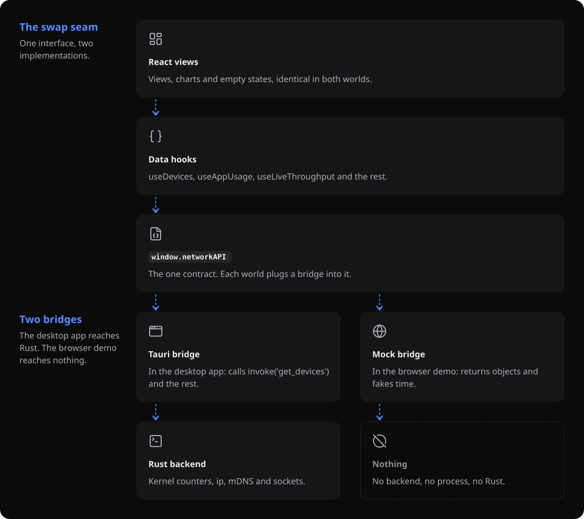
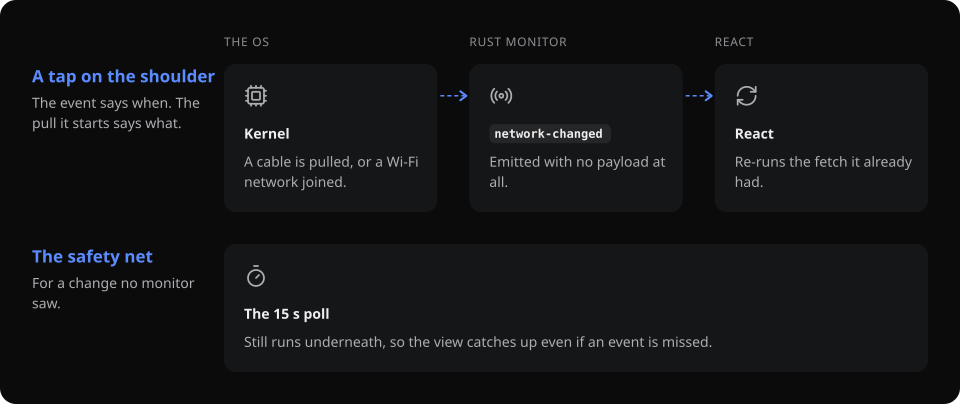

# How Rove Is Put Together

Four diagrams for the decisions that shape everything else: where the UI stops
and the backend starts, which direction data moves, and what a call across that
gap actually is.

> **Companion pages:**
> - [Learning Rust & Tauri through Rove](learning/rust-and-tauri/README.md): the same
>   boundary from the language side, with the Rust concepts spelled out.
> - [How Rove Captures Network Data (per OS)](networking/data-capture.md): the
>   per-OS probes behind every command below.
> - [How Rove Discovers & Identifies LAN Devices](networking/device-discovery.md): the
>   device-scan pipeline in full.

---

## 1. The swap seam

Every screen reads from one object on `window`. Two things can supply it, and
nothing above the line can tell which one did.

<div align="center">
  
</div>

`apps/rove/src/types/api.ts` declares the interface. Two files implement it:
`apps/rove/src/bridge/tauri-network-api.ts` forwards each method to a Tauri command, and
`apps/rove/src/bridge/mock-network-api.ts` answers from memory. `apps/rove/src/main.tsx` picks one at
startup:

```ts
if (isTauri()) {
  installTauriBridge()
} else if (import.meta.env.DEV) {
  installMockNetworkApiIfNeeded()
}
```

The mock isn't a fixture file: it fakes *time* as well as data: calls resolve
after a plausible delay, live throughput ticks once a second with a periodic
burst, and a speed test runs a scripted ten-second ramp that can be cancelled
mid-flight. Which is why `pnpm dev` gives a fully populated UI in a plain
browser, why `pnpm screenshots` produces the same shots on any machine
without leaking a real SSID, and why the same build can run inside an iframe as
a live demo.

Two consequences worth knowing:

- **Nothing keeps the two type definitions in sync.** Serde guarantees the
  Rust struct matches the JSON it emits; nothing checks that against the
  TypeScript. Rename a field in Rust and the UI still compiles, then reads
  `undefined` at runtime. `ts-rs` or `specta` would close this by generating one
  side from the other.
- **The mock re-implements one rule.** `rateCapability` in the mock mirrors
  `rate` in `crates/rove-core/src/capabilities.rs` so demo ratings match
  production. Two copies of one rule, and nothing checks they agree.

**Not everything goes through the bridge.** Two files call Tauri directly:
`features/about/hooks/useAppVersion.ts` (app version) and
`app/utils/updater.ts` (check and relaunch). Both are desktop-only by nature with nothing
meaningful to mock, and each degrades to nothing in a browser. The rule is:
*anything the UI renders goes through the bridge; anything that only exists on a
desktop doesn't.*

---

## 2. Two directions, and only seven exceptions

<div align="center">
  
</div>

**Pull when React knows it needs something**: a tab opened, a button was
pressed, a poll fired. That covers roughly thirty commands, registered in
`apps/rove/src-tauri/src/lib.rs` and implemented in `apps/rove/src-tauri/src/commands.rs`.

**Push when only Rust knows something happened.** Seven events qualify, each
because it is continuous, arrives mid-operation, or is triggered from outside
the app. Rust emits them all through `emit_to_ui` in
`apps/rove/src-tauri/src/ui_events.rs`, mostly from
`apps/rove/src-tauri/src/monitors.rs`:

| Event | Why it can't be pulled |
|---|---|
| `live-throughput` | 1 Hz forever; polling it would be silly |
| `speed-test-progress` | one call takes ~10 s, progress must arrive *during* it |
| `network-changed` | only the kernel knows you pulled the cable |
| `internet-status` | a background heartbeat notices, not the UI |
| `services-timeline` | runs even with the window closed |
| `app-usage` | a background sampler reads per-app bytes every 4 s |
| `host-usage` | a background sampler reads remote hosts every 6 s, then again once names and flags land |

`network-changed`, `services-timeline`, `app-usage` and `host-usage` carry no
payload: each says "this changed, refetch" (the next section).

Push costs more than pull: subscribe, unsubscribe, tear down on unmount, and
handle events that land *after* teardown (`useOnNetworkChanged` keeps an
`isActive` flag for exactly that race). So it stays rare.

Two places the directions mix:

- **Pull to turn push on.** `subscribe_live_throughput` / `unsubscribe_live_throughput`
  are ordinary commands that flip an atomic flag; the 1 Hz loop in
  `apps/rove/src-tauri/src/monitors.rs` skips its work entirely while it's false, so an
  unwatched window costs nothing.
- **Push that triggers a pull**: the next section.

---

## 3. The event that carries nothing

<div align="center">
  
</div>

A 15-second poll is correct and feels dead. Rather than build a second data path
for instant updates, `network-changed` ships **no payload at all**:

```rust
emit_to_ui(&handle, "network-changed", ());
```

`emit_to_ui` logs a failed emit through `log_if_failed` rather than returning
it: the poll catches up either way.

React answers it by re-running the fetch it already had:

```ts
useOnNetworkChanged(() => void refetch({ cancelRefetch: false }))
```

So the connection card updates within about a second of a cable pull, the poll
stays as the safety net, and there is no second payload to keep in sync with the
request path. The tap says *when*; the existing pull says *what*.

The monitor behind it, `spawn_route_monitor` in
`apps/rove/src-tauri/src/monitors.rs`, runs on all three OSes: `ip monitor route`
on Linux, `route -n monitor` on macOS, and a long-lived PowerShell listening to
.NET's `NetworkChange` on Windows. If it can't start, the poll still runs.

---

## 4. What one `invoke` actually is

<div align="center">
  
</div>

Tauri registers custom URI schemes with the webview, the same mechanism that
serves the bundled UI out of the binary. Two are in play: `tauri://localhost`
for assets (`http://tauri.localhost` on Windows), and `ipc` for commands.

A command call is shaped like HTTP but never reaches the network. The command
name is read from the URL path, the arguments are the JSON body, and a
`Tauri-Response` header of `ok` or `error` is what decides whether the promise
resolves or rejects. `Tauri-Invoke-Key` is checked so page content can't fire
commands on its own, defence in depth alongside
`apps/rove/src-tauri/capabilities/default.json`, which already limits the webview to our
commands, event listening and the frameless-window controls.

There is no local HTTP server and no open port; nothing else on the machine can
connect to it.

**Sync vs async matters on the Rust side.** Every command returns a promise in
JavaScript, but a plain `fn` command runs on the main thread while an `async fn`
runs on a thread pool. The split in `commands.rs` follows that: anything that
probes, shells out, hits the network or touches the database is `async`
(`get_devices`, `run_speed_test`, `get_speed_history`); only cheap in-memory
reads are sync (`get_app_usage`, `cancel_speed_test`). A slow command declared
sync would freeze the window while the UI politely awaited it, and nothing in
the type system would warn you. Inside an `async` command, a database call still
blocks, so it goes through `Store::run_blocking`, which runs it on tokio's
blocking pool instead of an async worker.

Commands fail with `CommandError` (`apps/rove/src-tauri/src/error.rs`), which
wraps each core error type (the store's, the speed test's, the Wi-Fi share's),
an `io::Error`, and the elevation errors (declined on Windows, unsupported
elsewhere), and serializes as its message: the UI only ever sees a string.

---

## Where the frameworks stop

| Written for Rove | Came with the tools |
|---|---|
| The bridge: one object on `window`, two implementations | The window: native, frameless, from JSON config |
| The contract: TypeScript types mirrored by Rust structs | The IPC transport plus the `#[tauri::command]` glue |
| The mock: data *and* time, ~1,500 lines | Asset embedding: the UI compiled into the binary |
| `useBackendQuery`: loading, polling, pause-when-hidden, race handling | Permissions: the deny-by-default capability manifest |
| The live store: one owner, 60 s history, idle hysteresis | Installers: deb, AppImage, dmg, nsis, msi, and signing |
| Every measurement in `crates/rove-core` | Rendering: React renders; it has no opinion on fetching |

Tauri owns the container and the pipe; serde owns the translation; the bridge
owns the naming. Keeping a seam of our own *above* the framework's seam is what
makes the mock (and therefore the browser demo) possible at all.

---

## Where everything lives

The whole repository, folder by folder.

```
rove/
├── apps/rove/                  the app's workspace (npm package `rove`)
│   ├── index.html              the page Vite serves; vite.config.ts beside it
│   ├── src/                    React UI (Vite)
│   │   ├── main.tsx            entry: installs the bridge, mounts the app
│   │   ├── app.css             the library's styles plus a scan of the app
│   │   ├── app/                the shell, laid out like a feature: App.tsx
│   │   │                       (providers) and AppShell.tsx at the top, then
│   │   │                       components/ (title bar, nav rail,
│   │   │                       CurrentScreen), context/ (navigation, theme,
│   │   │                       network), hooks/ (useNetwork,
│   │   │                       useInternetStatus, useConnectionStatus, …)
│   │   │                       and utils/ (incl. the TanStack query client)
│   │   ├── features/           one folder per area: home, speed,
│   │   │   │                   capabilities, connection, current-network,
│   │   │   │                   live-throughput, interfaces, devices, events,
│   │   │   │                   usage, apps, services, timeline, settings,
│   │   │   │                   about
│   │   │   └── <area>/         its views at the top
│   │   │       ├── components/ parts of those views, when a view has them
│   │   │       ├── context/    its own context, if it ever needs one
│   │   │       ├── hooks/      that area's data and state hooks
│   │   │       └── utils/      its plain helpers (no React)
│   │   │                       (capabilities, current-network and
│   │   │                       live-throughput have no view, so their parts
│   │   │                       sit at the top; timeline holds only components)
│   │   ├── hooks/              shared hooks (useBackendQuery is the
│   │   │                       useQuery shape every data hook builds on)
│   │   ├── utils/              shared helpers (format, platform, highlight)
│   │   ├── types/              the UI↔backend contract (mirrored in Rust)
│   │   └── bridge/             the contract's two implementations: Tauri, and
│   │                           the browser mock (pnpm dev without Tauri)
│   └── src-tauri/              thin Tauri shell: one #[tauri::command] per
│       │                       service, events, capabilities, window config
│       ├── linux/              .deb install/remove scripts, AppArmor profile
│       └── macos/              the optional root DHCP helper's LaunchDaemon
├── packages/ui/                the component library's workspace, imported
│   │                           by the app as @swiftsolve/rove-ui
│   ├── src/                    a folder per component (with its stories and
│   │   │                       tests), icons, and index.ts, the public API
│   │   ├── styles/             the global CSS: tailwind.css (the theme from
│   │   │                       the tokens; imports the rest), base.css
│   │   │                       (fonts, resets) and utilities.css (shared
│   │   │                       type styles and layout, as utilities)
│   │   └── fonts/              the faces base.css loads
│   ├── catalog/                the library as data: components.gen.json
│   │                           (written by pnpm gen), figma/ (components
│   │                           and guides, exported from Figma by pnpm
│   │                           figma:export) and figma-differences.json (by
│   │                           hand: where code and Figma differ, and why)
│   ├── cli/                    rove-ui, which prints the catalog a component
│   │                           at a time (pnpm rove-ui --help): program.ts
│   │                           (the commands), catalog/ (reads it), output/
│   │                           (text and Markdown) and pick/ (the prompts)
│   └── .storybook/             the library's Storybook and its Docs pages
├── crates/rove-core/           all platform services in pure Rust (no Tauri/GTK
│   │                           deps, so it compiles and tests anywhere), a module per
│   │                           domain, named as in apps/rove/src/features: apps/,
│   │                           capabilities, connection, devices/, diagnostics,
│   │                           interfaces, live_throughput, services, speed,
│   │                           usage; plus platform/ (per-OS probes), store/
│   │                           (SQLite, a file per domain) and utils/ (net,
│   │                           shell, geoip, mac, tls)
│   └── data/                   bundled lookup tables: OUI, IP-to-country,
│                               IP-to-ASN, hosting-asns.txt and
│                               dhcp_fingerprints.tsv
├── scripts/                    tooling: checks/ (the lint gates `pnpm lint`
│                               runs), gen/ (the *.gen.* files `pnpm gen`
│                               writes), hooks/ (git and Claude Code), eslint/,
│                               screenshots and the a11y audit; TypeScript that
│                               Node runs as is, typed by its own tsconfig.json
├── schemas/                    a JSON Schema for each project JSON file
│                               (components, figma-components,
│                               figma-differences, figma-guides, cn-theme): what
│                               each key means; the generators validate against them
├── docs/                       the deeper dives (index in docs/README.md),
│                               diagrams and screenshots
└── turbo.json                  the workspaces' tasks (typecheck, test, build),
                                which turbo runs in dependency order and caches
```

