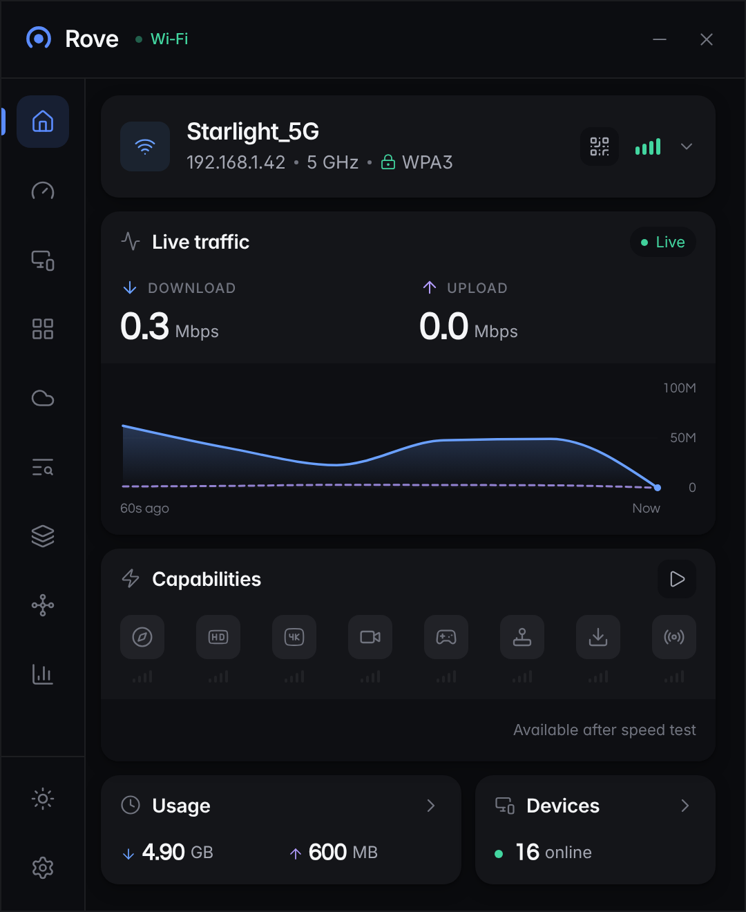
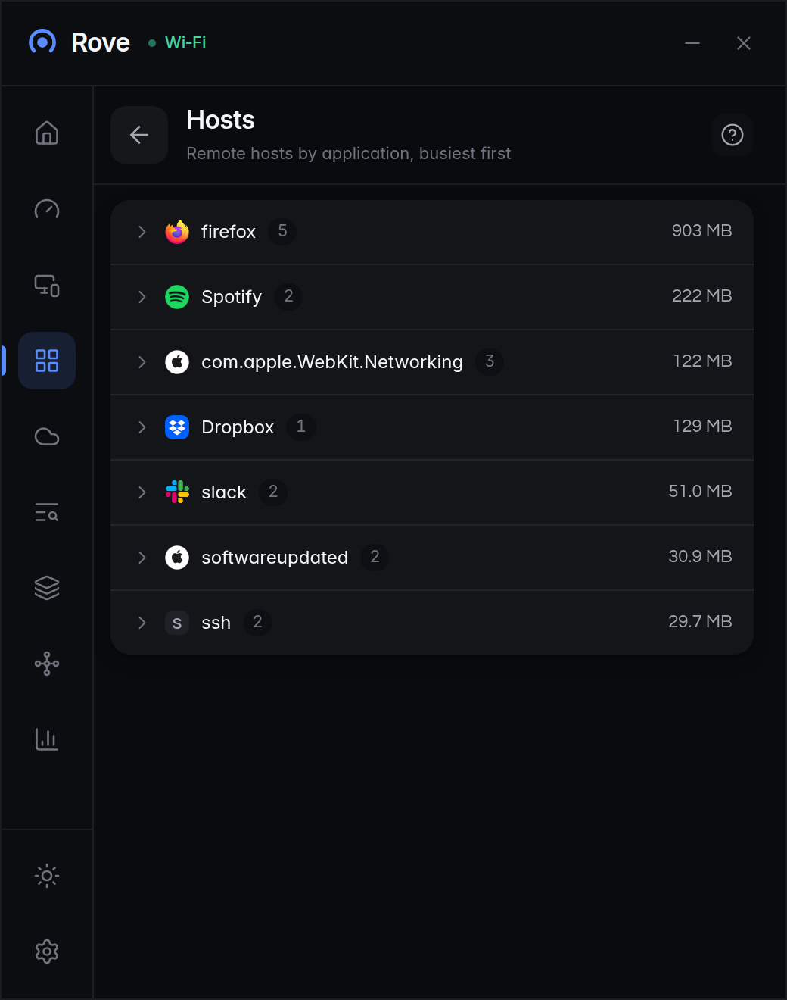
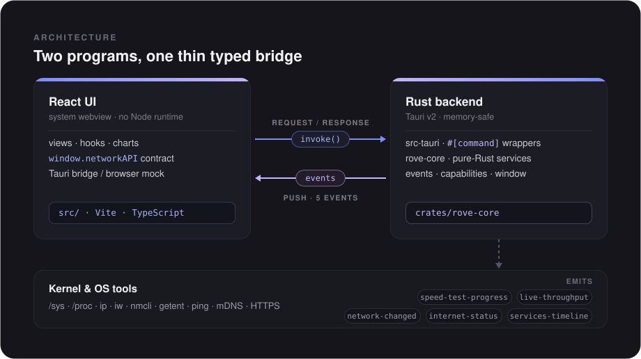
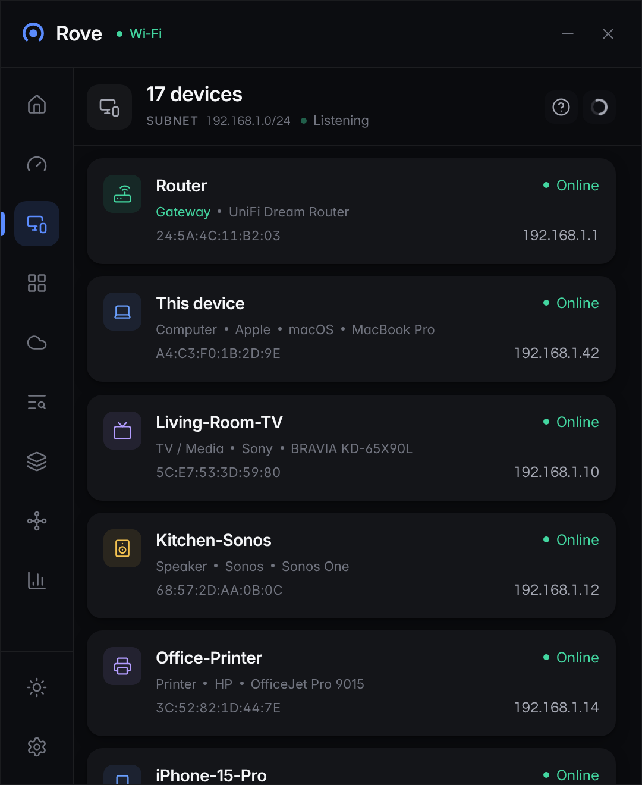
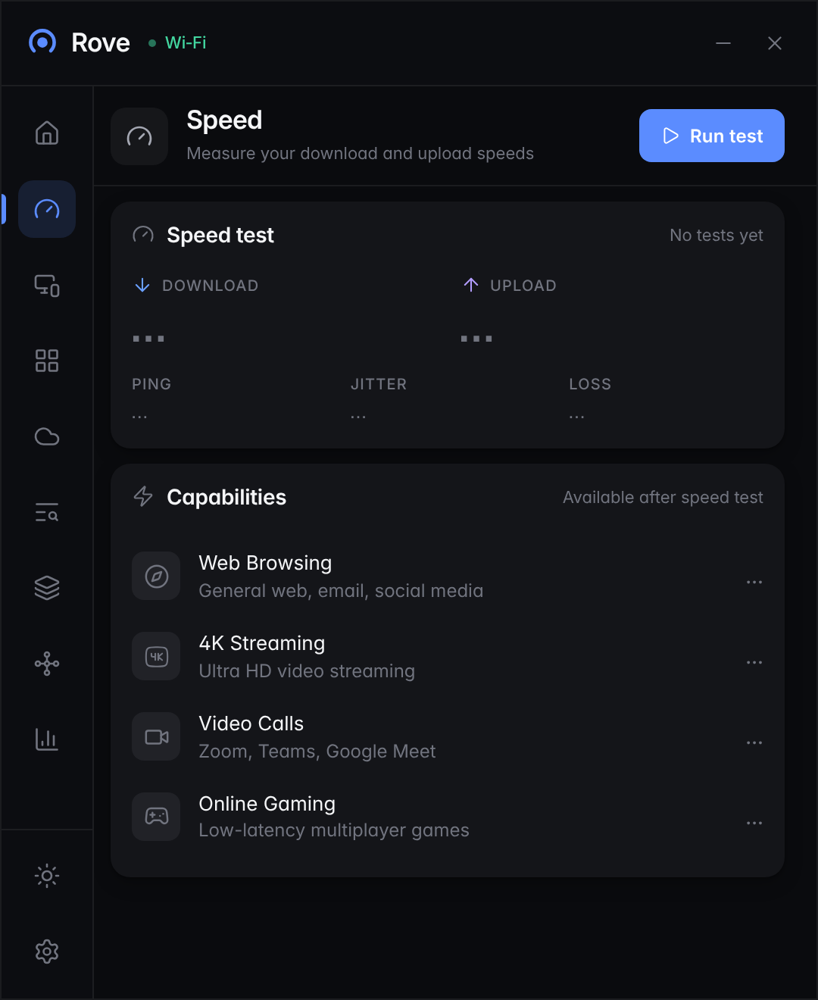

# Building Rove: a desktop network monitor that tells you the truth

**A case study in shipping a cross-platform network monitor that's honest about
what it measures, private by construction, and small enough to feel free.**

Rove is a desktop app that answers the questions people actually ask about their
connection — *is it slow right now, or is it me?*, *what's on my network?*,
*which app is eating my data?* — in a UI that reads like an instrument panel
rather than a diagnostic dump. It's a React frontend over a pure-Rust service
layer, packaged with Tauri v2, running on Linux, macOS and Windows from one
codebase.

This is the story of the design and engineering decisions behind it: the
problem, the UX and IA choices, the component system, the parts that fought
back, and what actually shipped.

<div align="center">
  
</div>

---

## 1. The problem

### The question nobody can answer

When a connection misbehaves, the tools available split into two useless
extremes.

On one side: **the browser speed test**. It gives you two big numbers, once,
about a link you weren't using at the time, and no memory of what those numbers
were last week. It cannot tell you whether the 8 pm slowdown is your ISP, your
neighbour's router on the same channel, or the machine quietly uploading a photo
library.

On the other: **the professional tooling** — Wireshark, `ss`, `nettop`,
`netsh`, a router admin page, `ip route`. Every fact is available, and every one
of them costs a context switch, a command you have to remember, and output you
have to parse in your head. None of it composes into an answer.

Between them is a gap: a resident, always-honest view of *your* connection —
what it is right now, what it can do, who's on it, and where the bytes went.

### Why the obvious solutions don't fill it

The ones that try tend to fail in one of four predictable ways:

| Failure | What it looks like |
|---|---|
| **The Electron tax** | A 150 MB download and 300 MB resident to show six numbers. A network monitor is a *background* app; if it costs more than the thing it monitors, it gets uninstalled. |
| **The privacy inversion** | A tool that watches your traffic and then phones home about it. Per-peer geolocation lookups are the classic tell: to draw a flag next to a host, the app hands a third party a list that is browsing history in all but name. |
| **The account wall** | Sign-in, telemetry, a subscription for the graph that was free last year. |
| **Confident wrongness** | The worst one, and the one that shaped this project most. A number that's plausible and wrong is worse than no number: it looks like data, so you act on it. |

That last failure is the design constraint the whole project ended up organised
around, because we shipped it ourselves and had to go back and fix it (§5.2).

### The goal, in one line

> A fast, small, keyless desktop app that shows you the truth about your
> connection — and never asks the internet a question about you to do it.

Concretely, that meant four commitments made up front and enforced since:

1. **Keyless.** Rove ships no API credentials and requires no account. Any
   feature that would need one doesn't get built. (Bundled lookup tables in
   place of hosted APIs — see §5.3.)
2. **No packet capture.** No libpcap, no Npcap driver, no elevation just to
   launch. Per-app attribution had to be built from what the OS will already
   tell an unprivileged process about its own sockets.
3. **Degrade, never lie.** A probe that fails renders as `—`, not as `0`. A
   platform without a data source says "unsupported", not "no traffic".
4. **Small.** The Linux `.deb` is ~5 MB. Tauri uses the OS's own webview, so
   there's no bundled Chromium and no Node runtime in the UI process.

---

## 2. UX decisions

### 2.1 The instrument-panel posture

Rove is not a document viewer, and it's not a dashboard you configure. It's an
instrument: numbers that are live, in fixed positions, with the same rhythm on
every screen.

That posture drove a set of concrete rules:

- **The window is chrome-light and drag-anywhere.** A frameless window with a
  custom status bar (`data-tauri-drag-region`), rounded corners clipped on
  `.app-shell` with a transparent `<body>` so the desktop shows through them.
- **Text isn't selectable by default** (`user-select: none` on `<body>`) —
  native apps don't let you drag-select their labels. (This one bit back on
  Windows; see §5.5.)
- **Tabular numerals everywhere.** Every readout uses a dedicated numeric face
  (Questrial) with `font-variant-numeric: tabular-nums`, so a value that changes
  every second doesn't make the row jitter as digit widths change.
- **Values ease, they don't snap.** `useCountUp` moves a displayed number 18%
  of the remaining distance per animation frame, settling within 0.05. Live
  readouts feel like a needle, not a counter — but only on *change*: first paint
  shows the value outright, so nothing counts up from zero on load.

### 2.2 Loading, error, and empty states are the product

Most of the interesting UX work in a live-data app is in the states where there
is no data. Rove treats them as first-class:

**A slow query is not a failure.** `describeNetworkError` in `App.tsx` splits
error text into three shapes with three different tones:

```ts
if (/timed out/i.test(message)) {
  return {
    kind: 'timeout',
    title: 'Network detection is taking too long',
    hint: 'This is usually temporary. Make sure you’re connected, then try again.',
  }
}
```

A timeout keeps the spinner and drops the retry button entirely — the hook
already re-polls every 15 s *and* on routing-table changes, so there is
genuinely nothing for the user to do but wait. Offering a button that changes
nothing is a small lie about agency. A real backend failure, by contrast, gets
an alert icon, a plain-language hint, and a retry that means something.

**A background failure never takes the screen away.** If a refresh fails while
data is already on screen, it degrades to a dismissible `ErrorBanner` above the
content — retry, dismiss, and the stale-but-real data stays visible. There is no
dead red bar the user can't clear.

**Blank states all go through one component.** Every "nothing here yet" page in
the app routes through `EmptyState` — one glyph size (32px), one title, one
optional hint, one optional action. Before that refactor, nine views had nine
slightly different empty states with different icon sizes and different verbal
registers; the consistency is more valuable than any individual page's
cleverness.

**Loading is scoped to what actually needs the data.** Only Home and Speed can't
render without network info. Every other tab renders its own chrome immediately,
so the nav rail and window controls stay usable while detection is still
running.

### 2.3 The status bar tells the difference between "link" and "internet"

Naïve connectivity UI treats "the Wi-Fi is connected" as "you're online". Those
are different facts, and the difference is exactly the situation a user opens a
network monitor to understand.

The top bar layers WAN reachability over the local link into three tones:

| Tone | Meaning |
|---|---|
| `on` | A link that reaches the internet — shows the connection type. |
| `bad` | Link up, public internet unreachable (ISP outage, a bridge with no WAN route) — "No internet", red. |
| `off` | No usable link at all — "Offline". |

Crucially, `internet` is `null` until the first background heartbeat lands, and
that null is treated as *fine*, not as an outage. Otherwise every launch would
flash a false red state for a second — the app crying wolf about itself.

### 2.4 Progressive disclosure over a speed number

A raw "184 Mbps" is a number most people can't act on. The speed test's results
feed a **capability assessment**: eight named activities (4K streaming, cloud
gaming, video calls, live streaming…) each rated `excellent` / `good` / `fair` /
`poor` / `unsupported` against per-activity thresholds on download, upload,
latency *and* jitter.

```rust
Def { id: "cloud-gaming", label: "Cloud Gaming", description: "GeForce NOW, Xbox Cloud",
      min_down: 25.0, min_up: 3.0, max_latency: 40.0, max_jitter: 10.0 },
```

This is what makes latency and jitter legible to a non-specialist: a link can be
fast and still rate poorly for cloud gaming, and the UI shows *why* — because
40 ms is the bar and you're at 90. Home shows a compact capability strip; the
Speed tab shows the full list; tapping one opens a details subpage with the
thresholds it's measured against. Three levels of depth, entered by curiosity
rather than configuration.

### 2.5 Honest measurement, stated out loud

The speed test saturates the link for ~6 s per direction with parallel HTTPS
streams. At multi-gigabit rates that moves 1–2 GB of data. Rather than hide
that, the app and the README say it plainly: *"Fair warning: at multi-gigabit
rates one test moves 1–2 GB. That's inherent to how throughput measurement
works."*

The same instinct shows up in "since boot" usage totals, which are read straight
from the kernel's `/sys/class/net/*/statistics` at query time rather than from
Rove's own accumulated bookkeeping. When kernel truth is available, show kernel
truth.

### 2.6 Permission is asked for at the moment of value

Two platform permissions are handled by *not* asking at launch:

- **macOS Local Network access** — required for LAN device discovery. Rove
  doesn't auto-scan when Home loads on macOS; the Home widget shows a **Scan**
  button instead. The permission prompt therefore arrives attached to a thing
  the user just asked for, not as an unexplained modal three seconds after
  first launch.
- **Windows administrator rights** — required to start the ETW session that
  powers per-app usage. Rather than a `requireAdministrator` manifest gating the
  *entire app* behind UAC, the per-app views show an empty state with a
  **Restart as administrator** button. Everything else in Rove stays usable
  unelevated. (The engineering behind this is §5.4.)

### 2.7 Motion with a job

Animation is used in exactly three places, each carrying information:

- **Staggered entrance.** Cards in a view animate in at 45 ms intervals for the
  first four, then a shared 180 ms delay for the rest — enough to read as
  "this page is assembling", bounded so a long list never feels slow.
- **The theme transition.** The light/dark swap runs inside a View Transition
  with a `clip-path` circle growing from the window centre; the built-in
  cross-fade is suppressed so only the circular reveal plays, with the z-order
  mirrored per direction so the *incoming* theme is always the one being
  revealed.
- **Scroll reset on navigation.** Every screen change resets scroll to the top,
  so a new page never inherits the previous page's scroll offset.

---

## 3. Information architecture

### 3.1 Nine tabs, one axis

Rove's navigation is a left rail of icon-only items with tooltips, ordered by
**how often you'd look, not by how the system is layered**:

```
Home · Speed · Devices · Apps · Services · Timeline · Interfaces · Connection · Usage
                                                                   ⚙ Settings
```

The rail top-to-bottom runs from *most-glanced* to *most-deliberate*. Settings
sits alone at the foot, separated by the theme toggle. **About is deliberately
not in the rail** — it's reached from inside Settings, because a nav slot is
expensive and an About page earns roughly one visit per install.

Each tab answers exactly one question:

| Tab | The question |
|---|---|
| **Home** | Is everything OK right now? |
| **Speed** | What can this connection actually do? |
| **Devices** | Who else is on my network? |
| **Apps** | Where did my data go? |
| **Services** | Is *this specific* thing down, or is it me? |
| **Timeline** | What changed while I wasn't looking? |
| **Interfaces** | What adapters exist and what state are they in? |
| **Connection** | Gateway, DNS, and the health of the first hop. |
| **Usage** | How much have I used, over time? |

### 3.2 Home is a hub, not a summary

Home doesn't just display condensed copies of the other tabs — every block on it
is a **door**. The capability strip opens the matching capability's details
subpage in Speed; the usage figure opens Usage; the device count opens Devices;
the throughput chart opens Speed. The props tell the story:

```tsx
onOpenCapabilities={(capabilityId) =>
  navigate({ tab: 'speed', speedSub: { view: 'details', target: capabilityId } })}
onRunSpeedTest={…} onOpenUsage={…} onOpenDevices={…}
```

The IA payoff: users never need to learn the rail's taxonomy to reach anything.
They follow the number they're already looking at.

### 3.3 Locations, not routes

There's no router. Navigation is a small typed state machine — an `AppLocation`
of a tab plus an optional, **tab-specific** subpage union:

```ts
export interface AppLocation {
  readonly tab: AppTab
  readonly speedSub: SpeedSub | null      // 'details' (with a target) | 'history'
  readonly servicesSub?: ServicesSub | null   // 'timeline'
  readonly appsSub?: AppsSub | null           // 'hosts' (optionally focused) | 'traffic'
}
```

Two properties fall out of typing it this way:

- **Illegal screens don't compile.** There is no way to express "the Speed
  history subpage over the Devices tab".
- **Back always lands somewhere real.** `parentLocation` gives every subpage a
  fallback parent (its own tab's main page; otherwise Home), so Back never
  escapes the app into whatever the webview had loaded before.

`locationKey()` flattens a location to a stable string, used to key the
scroll-reset effect — one line, and no page ever inherits another's scroll.

### 3.4 Depth is capped at two

Every screen in the app is either a tab or one subpage over a tab. There is no
third level. The `Apps → Hosts` subpage can be entered *focused* on a single app
(`appsSub: { view: 'hosts', app: 'Firefox' }`), which opens that group expanded
and the rest collapsed — the same screen serving both "show me everything" and
"show me this one", instead of a deeper page that would exist only to hold a
filter.

<div align="center">
  
</div>

### 3.5 Data fetching follows attention

The IA isn't only visual — it governs what the backend is asked to do. Almost
every hook is gated on the tab being open:

```ts
useNetworkInterfaces(activeTab === 'interfaces')
useHostUsage(activeTab === 'apps' && location.appsSub?.view === 'hosts')
useDevices(activeTab === 'devices' || (activeTab === 'home' && !IS_MAC && homeDeviceScan))
```

A closed tab costs nothing. Three deliberate exceptions prove the rule:

1. **Live throughput is owned by the app shell**, not by Home, and keeps
   sampling while the window is visible on *any* tab — so returning to Home
   shows a current 60-second history instead of resuming a stale snapshot.
2. **The services heartbeat runs in the Rust backend**, so the outage timeline
   keeps accruing with the tab closed and the window shut. The UI-side
   sparklines accrue only while you're watching; the *timeline* is backend
   truth.
3. **Data usage is warmed by Home**, since Home displays it.

### 3.6 The network is a cache key

A network switch invalidates everything keyed to the old one:

```ts
const networkKey = info ? `${info.interfaceName ?? ''}|${info.ipAddress ?? ''}` : null
```

That key is passed to `useDevices`, `useDiagnostics` and `useServiceReachability`
as a `resetKey`. Join a different Wi-Fi network and the device list doesn't
briefly show the café's printers alongside your home NAS. This matters more than
it sounds: the app is *named* for the fact that networks change under you.

Change is also pushed, not polled: the backend watches `ip monitor route` and
emits `network-changed` within ~1 s of a cable pull or Wi-Fi join, so state never
waits on the 15 s poll.

---

## 4. Design system and components

### 4.1 Tokens first, and one scale each

`src/index.css` defines the entire visual language as CSS custom properties.
Four things are notable about how it's organised.

**Surfaces are an elevation ladder, not a palette.** Six background tokens
(`--bg-app`, `--bg-app-2`, `--bg-panel`, `--bg-panel-hi`, `--bg-inset`,
`--bg-hover`) plus two shadow tokens, so a panel reads as a raised surface lit
from above rather than an outlined rectangle. Borders are near-invisible
hairlines (`rgba(255,255,255,0.07)`); depth comes from shadow.

**One 2px-based spacing scale, and it's enforced.** `--gap-2xs` through
`--gap-xl` plus `--row-py`. The comment in the file is the rule: *"every
gap/pad/margin should be one of these."* Card padding is a single
`--section-pad: 14px` on all four sides, matched to the 14px stack gap, so cards
read as evenly inset.

**Two type families with distinct jobs.** Inter for UI text (with `cv11` and
`ss01` feature settings on), Questrial for every number. Eight size steps from
`--text-micro: 10px` to `--text-display: 28px`, and three weights. Semantic type
classes — `.section-title`, `.field-label`, `.text-value`, `.text-hint`,
`.text-meta` — mean views describe *what a piece of text is*, never how it
looks.

**Colour is semantic and rationed.** `--positive` / `--warning` / `--negative`
surface through `.val-good` / `.val-warn` / `.val-bad`, with the comment
*"encode health in colour, only where it's earned."* The two chart series have
their own tokens (`--series-down`, `--series-up`) so a download and an upload
are the same two colours in every chart in the app.

### 4.2 Light mode as a token remap

Because the UI is driven almost entirely by tokens, light mode is one selector —
`:root.theme-light` — remapping the same variable names. Surfaces invert to a
soft-grey backdrop with white cards; hairlines and overlays flip from
white-on-dark to black-on-light; accents deepen for contrast.

The escape hatches are instructive. A handful of overlays were written as
hardcoded `rgba(255,255,255,…)` for "lift" — a scrollbar thumb, a nav hover, an
icon chip background — and those *have* to flip to black-on-light or they simply
vanish on a pale surface. Rather than hide that, the stylesheet lists them
explicitly under a comment naming why. A token system's honesty is in how it
documents its exceptions.

### 4.3 The component layer

Components are grouped by whether they know anything about networks:

```
components/
├── ui/            app-agnostic chrome (Section, DataRow, EmptyState, TabBar,
│                  Tooltip, Subpage, ViewHeader, Sparkline, MarqueeText, Toggle…)
├── connection/    connection card + display helpers
├── traffic/       live throughput panel, chart, readouts
├── speed-test/    speed test section + history
├── capabilities/  capability list, strip, details, meter, rating
└── diagnostics/   services pages, tally, latency history
```

`ui/` never imports from a feature folder. That boundary is what lets the whole
app share one rhythm — and what makes a change to card padding a one-line edit.

The four load-bearing primitives:

**`Section`** — the card. Header with an optional icon, a title, an optional
action slot on the right, a body, and an optional footer. Every panel in the app
is one. Because the header geometry lives in tokens (`--section-header-h: 44px`,
`--section-header-min: 42px`), cards on different pages align across the fold.

**`DataRow`** — the label/value pair, and the app's smallest opinion:

```tsx
export default function DataRow({ label, value, children }: DataRowProps) {
  if (value == null && !children) return null   // ← the whole idea
  return (
    <div className="data-row">
      <span className="field-label">{label}</span>
      <span className="text-value num">{children ?? value}</span>
    </div>
  )
}
```

**A row with no value renders nothing at all.** Given per-OS probes that
routinely return `None`, this single guard is what keeps a card from becoming a
field of dashes on a platform that can't supply half the facts. The card shrinks
to what's actually known.

**`ViewHeader`** — the page header: a 38px icon chip that deliberately matches
the selected nav item's chip geometry (38px box, 10px radius), so the page icon
and its rail counterpart read as the same control. Its subtitle slot **reserves
its line height even before content arrives**, so the title doesn't jump when
an async subtitle resolves.

**`EmptyState`** — one blank state for the entire app (§2.2).

Supporting cast worth naming: `Subpage` (back button + title + description,
with the shared entrance animation), `MetricValue` (a number wired to
`useCountUp`), `MarqueeText` (long names that scroll rather than truncate),
`Sparkline` (per-service latency history), `Tooltip` (the nav rail's only label
mechanism), and `ServiceIcon` (brand mark with a letter-monogram fallback).

### 4.4 `useBackendResource`: the data-fetching component

The most reused piece in the codebase isn't visual. Every "load something from
the backend" hook — interfaces, devices, usage, diagnostics, events, app usage,
host usage, traffic — is a thin wrapper over one shared hook with one shape:
`{ data, isBusy, error, reload }`.

Its options encode hard-won behaviour:

- **`resetKey`** — cache invalidation on network change (§3.6).
- **`pollIntervalMs`** — a *silent* background refresh that updates values in
  place without flashing a spinner or clearing a visible error.
- **`fetchOnEnable: false`** — for a poll-only resource seeded by a sibling
  snapshot, so opening a tab doesn't fire a second probe of the same targets.
- **Visibility-aware polling** — polling pauses when the window is
  backgrounded and refreshes once on resume. Without it, the webview's throttled
  timers wake and fire a burst of stale reloads (including a heavy device
  rescan) the instant the window returns.

There's a subtle bit of state machinery in there too: separate refs for load
ordering, busy-flag ownership, and mount liveness. Conflating the first and
third is what previously orphaned the initial fetch under React 18 StrictMode —
the simulated unmount bumped the sequence, the remount was skipped by the
run-once guard, and the in-flight result was dropped, leaving a spinner that
never cleared. Three refs, three jobs.

---

## 5. Engineering challenges

### 5.1 One truth, three operating systems

No OS exposes "your network state" through one API. Rove's approach is to shell
out to each OS's own battle-tested tools and parse them, with one command runner
that makes failure uniform:

```rust
pub async fn try_run(command: &str) -> Option<String>
```

**It returns `Option`, never `Result`.** A missing tool, a non-zero exit, a
15-second timeout, and empty output all collapse to `None` — so callers can
write fallback chains where a failed probe simply tries the next option. Every
call is async with a timeout, so a hung `nmcli` can't freeze the app. On
Windows, `CREATE_NO_WINDOW` stops each PowerShell probe from flashing a console.

Platform branches are **runtime `cfg!()` checks, not `#[cfg]` blocks**, wherever
possible — so every platform's code typechecks on every platform, and a Linux
dev can't break the Windows path without the compiler noticing.

Building shell strings from network-supplied values needs a guard, so two
gatekeepers stand in front of every interpolation. `is_shell_safe_ip` accepts a
value **only if it parses as a real `IpAddr`** — a parsed address can only
contain `[0-9a-fA-F:.]`, never a `;`, `|`, `$` or backtick. `is_shell_safe_iface`
bounds names to 40 characters of a safe alphabet and deliberately *allows
spaces*, because Windows really does have interfaces named `Ethernet 2`.
Separately, `sanitize_display` strips control characters and Unicode bidi
overrides from anything that arrived off the network (mDNS TXT records, reverse
DNS) before it's stored or rendered — a hostile neighbour doesn't get to inject
escape sequences into your device list.

Windows needed more than parsing. `Find-NetRoute` emits *two* rows — a bare
source-address selection with no `NextHop`, then the real default route — and
Windows will happily keep a stale metric-0 route on a just-unplugged Ethernet
adapter. So the real query is a filter chain plus a liveness check:

```powershell
$route = Find-NetRoute -RemoteIPAddress '8.8.8.8' | Where-Object NextHop | Select-Object -First 1;
if ($route -and (Get-NetAdapter -InterfaceIndex $route.InterfaceIndex).Status -eq 'Up') { $route.NextHop }
```

Without the `Status -eq 'Up'` guard, Rove confidently reports you're on
"Ethernet 2" while you're on Wi-Fi.

macOS moved under us mid-project: on 14.4+ the private `airport` tool was gutted
and now prints only a deprecation notice. Wi-Fi details — including the transmit
rate the shell tools no longer expose at all — are now read in-process via
CoreWLAN.

### 5.2 The hardest bug: per-app usage that invented traffic

**Symptom:** `mDNSResponder` reported 1.13 GB of network usage on macOS. The
attribution was right — those bytes really were its sockets — but the volume was
fiction, manufactured by our own accounting.

**Root cause, layer one.** The tracker credited any *decreased* counter with its
entire new reading, reasoning that a decrease means the key was recycled by a
fresh unit. That's true on Linux, where the key is a socket address pair. It is
badly wrong on macOS, where `nettop -P`'s key is a *process* and its counter is
the sum over that process's **currently open** sockets. The sum falls every time
a socket closes — so we re-banked the process's entire lifetime total on every
close. `mDNSResponder` is the pathological case by construction: it proxies all
system DNS (a large base) and opens a socket per query (constant churn),
crediting ~36 MB of phantom traffic every few seconds against a few hundred real
bytes.

**The first fix was to model the semantics explicitly** rather than assume one
shape:

| Source | A decrease means | Credit |
|---|---|---|
| **Socket** (Linux `ss`) | recycled address pair | the whole new reading |
| **ProcessAggregate** (`nettop -P`) | a closed socket leaving the sum | nothing |
| **PidAccumulator** (Windows ETW) | can't happen — ours, zero-based, monotonic | first sighting is all real |

Two further inflation paths closed with it. A *failed* sample returned an empty
vec, indistinguishable from an idle machine — so the tracker forgot every
baseline and re-credited the world on the next good tick; samplers now return
`Option` and skip a failed tick entirely. And the first snapshot banked counters
that accrued *before Rove was watching* (`mDNSResponder`'s whole 132 MB base,
the instant the app launched); the first sample now primes baselines only.

**Then the deeper problem surfaced.** "Credit nothing on a dip" stops the
inflation, but it *loses* whatever the surviving sockets moved during that same
tick. For anything holding several concurrent connections that finish and are
replaced — a download, a browser — that's most of the traffic. `appstored` read
31 MB against a true ~70 MB. Both readings were badly wrong, in opposite
directions, and **no accumulation strategy recovers from either**, because the
information is destroyed before Rove sees the number:

> `nettop -P` is a **gauge, not an odometer.**

**The real fix** was to stop reading the aggregate. Drop `-P` and read the
per-socket rows `nettop` prints beneath each process. They carry the same bytes
with the information intact — the process row is exactly their sum, so nothing
is given up — and a socket close becomes *one key going away* rather than an
unattributable dip. macOS now banks with Socket semantics like Linux, and
`ProcessAggregate` lost its last user and was deleted.

One trap remained. Keyed by address pair, **unconnected** sockets have no
identity at all: one music player held nine sockets all printing the identical
label `udp4 *:5353<->*:*` with different counters, which re-banked each other
every tick and read **1.4 GB in twelve seconds**. Sockets with a wildcard peer
are now excluded; a concrete peer makes the 4-tuple unique, and the loss is
bounded to discovery chatter rather than payload.

**Verified against ground truth:** a rate-limited 40 MB download over four
staggered connections banks 34.63 MB. The ~5.4 MB gap is the tail between each
socket's last sample and its close — the inherent limitation of any
snapshot-based approach, which comparable tools document too. A bounded lower
bound, where the aggregate had been structurally wrong.

The lesson generalises past this bug, and it's the one from §1: **a number that
is plausible and wrong is worse than no number.**

### 5.3 Privacy as an engineering constraint

The Hosts view geolocates every public peer an app talks to, to draw a country
flag. The original implementation asked a hosted API (`ipwho.is`) per peer,
which was two problems wearing one coat:

1. **Quota.** Peer churn could exhaust a free tier's daily allowance within
   minutes — and because the ISP card shared that budget, it silently blanked
   too.
2. **Privacy.** It handed a browsing-history-shaped list of peers to a third
   party.

The fix was to embed DB-IP's IP-to-Country Lite database (MMDB, gzipped ~3.9 MB,
decoded once on first lookup) and resolve on-device. No per-peer request leaves
the machine, it works offline, and — subtly important — **misses become stable
answers rather than transient failures**, so the tracker's cache no longer holds
a rate limit as if it were a fact about an address. It also retired the
per-tick lookup budget in the sampler: local table reads clear the entire
backlog in one pass.

The choice of *which* database was itself a licensing constraint. DB-IP over
MaxMind's GeoLite2, because GeoLite2's EULA requires destroying superseded
copies within 30 days of each twice-weekly release — **a term a binary already
installed on users' machines cannot honour.** Same reasoning picked IEEE's
registry over Wireshark's GPL-2.0 `manuf` file for MAC vendor lookup.

What's left crossing the network is deliberately short, and every item is about
*your own* address rather than a peer's: your public IP from `api.ipify.org`
(with ISP, ASN and country then resolved locally from bundled tables), a
best-effort enrichment call for your city, and brand icons by *domain* — never a
discovered peer, never a reverse-resolved hostname. Apps Rove doesn't recognise
fall back to a letter monogram and ask nothing.

### 5.4 Windows per-app attribution: ETW, elevation, and a leaked session

Linux and macOS give an unprivileged process per-socket byte counters for its
own sockets (`ss -tinHp`, `nettop`). Windows gives you nothing comparable —
short of a packet-capture driver, which was ruled out in §1. The path that works
is an **ETW consumer** of the `Microsoft-Windows-Kernel-Network` provider,
folding each send/receive event into a per-PID total. That needs administrator
rights to start the session, which produced a cascade of problems:

**The whole app can't be gated behind UAC.** A `requireAdministrator` manifest
would force every launch through an elevation prompt to enable one view. Instead
the per-app views show a "needs administrator" empty state with a **Restart as
administrator** action, which relaunches via the shell `RunAs` verb and exits
the unelevated instance once the elevated one is on its way. Decline the prompt
and the current instance keeps running with a short note. Everything else in
Rove works unelevated.

**One failure disabled the feature forever.** The starter latched its result in
a `OnceLock<bool>`, so a single failed first attempt — a still-tearing-down
prior session, a tick that landed pre-elevation — disabled per-app usage for the
entire process lifetime. Replaced with an `AtomicBool` retried on each sample,
serialised by a start lock, so recoverable failures recover.

**Then it still failed *after* elevating.** The session is deliberately leaked
so it lives for the whole process — which means it is never stopped, not on a
crash and not even on a clean exit. ETW sessions are **system-global**, so the
orphaned `RoveNetUsage` session outlives the process and the *next* launch fails
with `EtwNativeError(AlreadyExist)` — which the UI then misattributed to missing
elevation, telling an already-elevated user to elevate. Now, on `AlreadyExist`,
Rove stops the orphan by name and retries once before recording a start error.

**And the UI was hiding the answer.** The unsupported state only ever suggested
elevation, whatever the real cause. The starter now records its last error, a
`usage_support_detail` command exposes it, and the empty state renders a
`Details: <error>` line — so access-denied versus a policy or provider error is
visible without hunting through
`%LOCALAPPDATA%\rove\logs\rove.log`.

**The payoff for that work was larger than expected.** The ETW consumer had been
parsing PID and size and discarding the rest of each event — but those same
TcpIp/UdpIp events carry the connection's source and destination addresses and
ports. The peer was there all along, thrown away. Extending the consumer to keep
a second per-connection accumulator lit up **two entire views on Windows** —
Hosts and Traffic Types — with no new data source:

- The remote peer is whichever endpoint isn't one of this host's own interface
  addresses (enumerated via `if-addrs`), so it doesn't matter whether the
  provider labels addresses by packet direction or by connection role;
  both-local (loopback) traffic drops out.
- A `touched` flag prunes closed and idle connections each sample, so the map
  can't grow unbounded as ephemeral ports churn.
- Ports are byte-swapped out of the `win:Port` network order, or every
  connection classifies as "other" instead of 443/53.

### 5.5 The small ones that only reproduce on one platform

**Text inputs were untypeable on Windows.** The app-wide `user-select: none` on
`<body>` (§2.1) inherits into form controls. WebKit — the webview on macOS and
Linux — exempts them; WebView2/Chromium honours it and blocks typing entirely.
Every text field in the app was dead on Windows and nowhere else. Four selectors
re-enabling `user-select: text` on editable elements fixed it.

**Country flags rendered as boxed letters on Windows.** Segoe UI Emoji ships no
country-flag glyphs, so the regional-indicator pairs the Hosts view emits had
nothing to draw with — the country data resolved fine, the flag just didn't
exist. Fixed by bundling a ~78 KB Twemoji Country Flags woff2 subset applied
*ahead of* the UI font on the flag slot only: flags come from Twemoji, every
other character falls through to Inter. macOS and Linux have their own flags;
the font just makes the artwork consistent.

**A release shipped with no Windows assets.** The v0.0.3 run failed at the end
of `tauri build` with `failed to decode pubkey: Missing encoded key in public
key`. The installers themselves had built fine — the job exited 1 before
uploading them. Root cause: the updater public key in `tauri.conf.json` was
**base64-encoded twice**. Tauri decodes once and expects minisign public-key file
content; a double-encoded value decodes to more base64, which minisign-verify
rejects.

**A modal froze the app on Linux.** `window.confirm` blocks the webview on
WebKitGTK, so the update prompt is a non-blocking React modal instead — noted in
the code so nobody reintroduces it.

**Devices that don't want to be found.** Device discovery pings every host in the
/24 with 64 concurrent probes — but the point isn't the ICMP reply, it's the
**ARP exchange the attempt forces**, which enters idle devices into the kernel
neighbour table even when they drop ping. That runs concurrently with a ~3 s mDNS
listen where devices literally announce what they are, then `ip neigh` is read as
ground truth and each host is enriched with a vendor (MAC OUI), a hostname, and a
classification from ranked signals: role flags → mDNS service type → mDNS
hardware model → hostname patterns → vendor patterns → weak hints → `unknown`.
A device that blocks ping *and* announces nothing can still hide, and the docs
say so — the router's admin page stays authoritative.

---

## 6. Final implementation

### 6.1 The shape

Two programs over a thin typed bridge:

<div align="center">
  
</div>

```
rove/
├── src/                  React UI (Vite)
│   ├── views/            one file per page
│   ├── components/ui/    app-agnostic chrome
│   ├── components/*/     feature components
│   ├── hooks/            data hooks over window.networkAPI
│   ├── types/            the UI↔backend contract
│   ├── bridge/           the Tauri implementation of that contract
│   └── dev/              a browser mock of the same contract
├── crates/rove-core/     every platform service, pure Rust — no Tauri, no GTK
└── src-tauri/            thin shell: one #[tauri::command] per service
```

**Three decisions carry most of the weight.**

**1. The core crate has no framework dependencies.** `rove-core` is pure Rust —
no Tauri, no GTK — so it compiles and tests anywhere, `cargo check -p rove-core`
typechecks the whole service layer alone, and `cargo run -p rove-core --example
scan` prints a live LAN scan with no app running. `src-tauri/` is genuinely thin:
one command per service, plus events, capabilities and window config.

**2. The contract is one interface with two implementations.** TypeScript types
in `src/types/` define every payload; the Rust structs in
`crates/rove-core/src/types.rs` mirror them field-for-field, with serde renaming
to camelCase on the wire. The UI never knows it's talking to Rust — it talks to
`window.networkAPI`. `src/bridge/tauriNetworkApi.ts` implements that interface
over Tauri; `src/dev/mockNetworkApi.ts` implements the same interface in a
browser. **`npm run dev` therefore runs the entire UI in a plain browser with no
Rust toolchain**, which is what made the design iteration in §2 and §4
affordable.

**3. Request/response for facts, push for streams.** Each data need is one Tauri
command. Three things flow the other way as events: `live-throughput` (1 Hz),
`speed-test-progress`, and `network-changed`.

### 6.2 Security posture, as built

Tauri v2 is deny-by-default: the webview can call only what
`src-tauri/capabilities/default.json` grants — our commands, event listening,
and the frameless-window controls. There is no Node runtime in the UI process,
and the backend is memory-safe Rust. No API credentials ship in the binary,
because there are none to ship.

### 6.3 What it does, and what it costs

| | |
|---|---|
| **Platforms** | Linux, macOS, Windows — one codebase, CI builds all three bundles |
| **Bundle** | `.deb` ~5 MB, AppImage, dmg, nsis |
| **Runtime** | OS webview; no Chromium, no Node |
| **Accounts / API keys** | None |
| **Elevation** | Not required to launch; requested on demand for Windows per-app metering only |
| **Views** | 9 tabs + 5 subpages |
| **Live data** | 1 Hz throughput, 15 s network poll, ~1 s push on route change (Linux) |
| **Bundled tables** | MAC OUI (IEEE), IP→country and IP→ASN (DB-IP), hosting/VPN ASNs |

<div align="center">
  
  
</div>

### 6.4 Where the seams are — stated, not hidden

Every measurement in Rove has a boundary, and each one is documented rather than
papered over:

- **Socket-level accounting misses sockets that open and close entirely between
  two samples.** Bounded, measured (~13% on the verification download), and
  inherent to any snapshot approach.
- **Per-host UDP on Linux is still future work.** Linux reads `ss -tinHp` — TCP
  only — on both the Apps and Hosts views, so it's internally consistent. macOS
  meters TCP and connected UDP (QUIC) on both, so its two views reconcile up to
  sampling skew.
- **The instant network-change monitor is Linux-only.** macOS and Windows fall
  back to the 15 s poll.
- **On macOS, SSID sits behind Location Services.** Decline it and the network
  name shows `—` while everything else still resolves.
- **A device that blocks ping and announces nothing can hide.** The router's
  admin page stays authoritative.
- **Windows per-app views need administrator rights.** They say so, with the
  concrete error, and offer the elevation.

### 6.5 What the project taught

**Degrade, never lie — and make it structural.** `try_run` returning `Option`,
`DataRow` rendering nothing for a missing value, and `platform_support()`
reporting `"unsupported"` rather than an empty list are all the same decision at
three layers. The UI can't accidentally show a confident zero, because no layer
can produce one.

**Model your data source's semantics; don't assume they're uniform.** The most
expensive bug in the project came from treating three sources — a socket
odometer, a process gauge, and our own accumulator — as one shape. The fix
wasn't a better heuristic, it was reading a source that hadn't already destroyed
the information.

**Privacy constraints improve engineering.** Being unwilling to ask a hosted API
about each peer forced a bundled table, which is faster, works offline, has no
quota, and turns misses into stable answers. The ethical constraint and the
better architecture were the same choice.

**Tokens make a second theme a diff, not a project.** Light mode is one selector
remapping the same variable names, plus an explicit, commented list of the
hardcoded overlays that had to flip.

**A mock implementation of your own contract is a design tool.** Because
`window.networkAPI` has a browser implementation, most of the UI work in this
case study happened in a hot-reloading browser tab with no Rust in the loop.

---

## Further reading

- [`README.md`](../README.md) — what each feature measures, per-platform tool map
- [How Rove Captures Network Data (per OS)](./networking-data-capture.md)
- [How Rove Discovers & Identifies LAN Devices](./device-discovery.md)
- [Learning Rust & Tauri through Rove](./learning-rust-and-tauri.md)
- [Why "Rove"?](./why-rove.md) — the naming rationale
