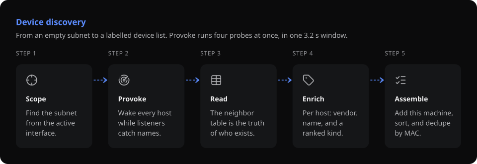
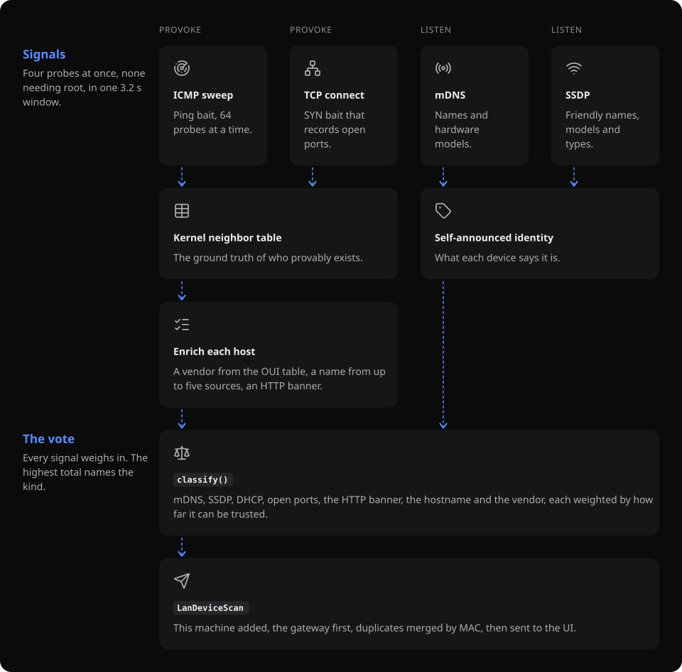

# How Rove Discovers & Identifies LAN Devices

The Devices screen answers a deceptively hard question: **"what's on my network,
and what is each thing?"** — without admin rights, without installing a driver,
and in a couple of seconds. This page walks the whole pipeline, from an empty
subnet to a labelled list of "Living-Room-AppleTV / tv" entries, using the real
code in `crates/rove-core/src/devices/` and its helpers (`mdns.rs`, `oui.rs`).

> Rove fuses **nine** unprivileged signal sources — an ICMP sweep, a TCP
> `connect()` probe, mDNS, SSDP/UPnP, reverse DNS, an HTTP banner grab, a
> NetBIOS name query, an SNMP `sysDescr` read of the gateway, and passive DHCP
> fingerprinting. No single one is complete; each fills gaps the others leave,
> and a trust-weighted vote reconciles them.

It doubles as a Rust lesson: this subsystem shows off async concurrency, the
`HashMap` entry API, weighted scoring over fixed arrays, `spawn_blocking`, and
compile-time-embedded data — all in service of one feature.

---

## The core problem

There is no OS API that just *returns* your LAN devices. What exists is the
kernel's **neighbor table** (a.k.a. the ARP cache on IPv4): a map of `IP → MAC`
for hosts the machine has *recently communicated with*. That's the closest thing
to ground truth — if an IP↔MAC pair is in there, that device provably exists and
responded at the link layer.

Two problems with using it directly:

1. **It's sparse.** It only holds hosts you've talked to lately. A phone or smart
   plug sitting quietly won't be in it.
2. **It's bare.** An IP and a MAC tell you nothing about *what* the device is.

So Rove's job is: (a) **populate** the neighbor table by provoking traffic to
every host, then (b) **read** it, then (c) **enrich** each bare entry into an
identified device. That's the pipeline.

---

## The pipeline at a glance

From `scan()` in `crates/rove-core/src/devices/mod.rs:45`:

<div align="center">
  
</div>

1. **Scope** — find my subnet (e.g. `192.168.1.0/24`).
2. **Provoke** — wake every host so it enters the neighbor table, while passive
   listeners collect self-announced identities (ICMP sweep ‖ TCP probe ‖ mDNS
   listen ‖ SSDP listen — all concurrent, ~3.2 s).
3. **Read** — the neighbor table = ground-truth list of who exists.
4. **Enrich** — per host, in one concurrent round: vendor (OUI) · hostname
   (rDNS ‖ HTTP banner ‖ NetBIOS) · model (SNMP) · kind (classify).
5. **Assemble** — add this machine, sort gateway→self→by-IP, dedupe by MAC.

The stage-2 probes/listeners all run concurrently, bounded by a single
`DISCOVERY_WINDOW` of 3.2 seconds (`mod.rs:32`), not the sum of their parts. The
stage-4 enrichments that hit the network — reverse DNS, the HTTP banner grab, the
NetBIOS query and the gateway SNMP read — are likewise fired together in one
`tokio::join!` (`mod.rs:103`), so their combined latency is one round, not four.
That concurrency is the reason the whole scan feels instant.

A tenth of a source sits *outside* the scan entirely: the **passive DHCP
listener** (§4g) runs for the app's lifetime and accumulates fingerprints as
devices join, so each scan just snapshots what it has collected
(`dhcp::snapshot()`, `dhcp.rs:143`).

---

## Stage 1 — Scoping the subnet

You can't sweep "the network" until you know its address range. `subnet_of`
(`devices/subnet.rs:7`) gets the interface's IPv4 + prefix length from the
platform probe (`ip -j addr` on Linux, `Get-NetIPAddress` on Windows, `sysinfo`
fallback) and turns it into a CIDR like `192.168.1.0/24`.

The arithmetic is pure bit-twiddling on the 32-bit integer form of an IPv4
address (`subnet.rs:29`, `subnet.rs:66`):

```rust
fn to_cidr(ip: Ipv4Addr, prefix: u32) -> String {
    let network = Ipv4Addr::from(u32::from(ip) & prefix_mask(prefix));
    format!("{network}/{prefix}")
}

pub fn prefix_mask(prefix: u32) -> u32 {
    if prefix == 0 { 0 } else { u32::MAX << (32 - prefix.min(32)) }
}
```

`prefix_mask(24)` is `0xFFFFFF00`; ANDing an IP with it zeroes the host bits,
leaving the network address. `contains()` uses the same mask to test membership,
which is how the scan later filters the neighbor table to *just this subnet*
(so a stale entry from a previous network doesn't leak in).

> **Rust note:** `u32::from(ipv4)` and `Ipv4Addr::from(u32)` are free,
> lossless conversions — an IPv4 address *is* a `u32`. Rove leans on this for
> all subnet math and for `ip_sort_key` (sorting devices numerically by address).

---

## Stage 2 — Provoking hosts (the ARP-table trick)

This is the clever core. To get a silent host into the neighbor table, you have
to make your kernel send it a packet — *any* packet — because to send one, the
kernel must first ARP-resolve the target's MAC, which creates the neighbor
entry. **You don't care if the host answers.** The ARP resolution already
happened; the entry is already cached. Rove does this two complementary active
ways, plus two passive listeners (mDNS and SSDP), all at once (`mod.rs:65-88`).

Both active probes now do double duty: waking the host is the point, but *who
answered* is also recorded, because a reply is the only proof a device is
present **right now** rather than lingering in a stale ARP cache (see
[Steadiness across scans](#steadiness-across-scans)).

### 2a. ICMP sweep — `devices/sweep.rs`

Ping every address in the subnet, 64 at a time:

```rust
futures_util::stream::iter(hosts.map(|ip| ip.to_string()))
    .map(|ip| async move {
        let cmd = crate::platform::ping_command(&ip, 1, 700);
        let replied = crate::shell::try_run_timeout(&cmd, Duration::from_secs(3))
            .await
            .is_some();
        replied.then_some(ip)          // a reply is a positive liveness signal
    })
    .buffer_unordered(CONCURRENT_PROBES)   // 64
```

A *failed* ping is still a success for discovery — the ARP resolution already
happened, so the host is in the neighbor table either way. The returned set of
repliers is a bonus the liveness logic consumes. The sweep only runs on
`/24`–`/30` subnets (`subnet::hosts`, `subnet.rs:57`) — sweeping a `/16` would be
65k pings, which is antisocial, and anything smaller than `/30` is pointless.

### 2b. TCP `connect()` probe — `devices/probe.rs`

An ICMP sweep misses hosts that *drop ping* — increasingly the default on phones
and hardened IoT. So Rove also tries to open a TCP connection to a short list
of tell-tale ports on every host (`probe.rs:23`):

```rust
const PROBE_PORTS: &[u16] = &[
    80, 443, 22, 9100, 631, 554, 8009, 8060, 32400, 1400, 62078, 445, 9999, 6668,
];
```

Same trick, stronger: to send the TCP SYN, the kernel must ARP-resolve the
target — so the host lands in the neighbor table **whether it accepts (SYN-ACK)
or refuses (RST)**. Either proves it's alive. And this needs *no raw sockets and
no privileges*, unlike a real ARP or SYN scan — it's just `TcpStream::connect`.

There's a bonus: a port that actually *accepts* is a strong hint about the device
type (9100 → printer, 8009 → Chromecast, 62078 → iPhone, 9999/6668 → smart plug).
So the probe returns both maps — open ports for the classifier, and every host
that answered at all for the liveness verdict (`ProbeResult`, `probe.rs:49`):

```rust
match timeout(CONNECT_TIMEOUT, TcpStream::connect(addr)).await {
    // Accepted — alive, and this port is open.
    Ok(Ok(_stream)) => Some((ip.to_string(), Some(port))),
    // Refused (RST) — port closed, but the host answered, so it's alive.
    // This is what catches a power-saving phone that ignores ICMP.
    Ok(Err(e)) if e.kind() == ErrorKind::ConnectionRefused => Some((ip.to_string(), None)),
    _ => None,   // silent/unreachable: ARP job still done, nothing proven
}
```

400 connections in flight at once (`CONCURRENT_PROBES`, `probe.rs:42` — sized to
stay under the 1024 open-file limit), 400 ms timeout each.

### 2c. mDNS listening — `mdns.rs`

While the two active probes hammer the network, a **passive** mDNS listener runs
in parallel. Many devices *announce themselves* over multicast DNS (`_ipp._tcp`
for printers, `_googlecast._tcp` for Chromecasts, `_sonos._tcp` for Sonos…).
This is the single best identity signal — the device *tells* you what it is,
often with a friendly name ("Living room clock") and a hardware model
("MacBookPro18,3"). Rove browses ~35 service types (`SERVICE_KINDS`,
`mdns.rs:11`) via the pure-Rust `mdns-sd` crate.

> **Rust note:** `mdns-sd` is blocking, so it runs inside
> `tokio::task::spawn_blocking` (`mdns.rs:177`) — the right tool for wrapping
> synchronous work so it doesn't stall the async runtime's worker threads.

### 2d. SSDP / UPnP discovery — `devices/ssdp.rs`

A second passive-ish source runs alongside mDNS: an SSDP `M-SEARCH`. Many
consumer devices — smart TVs, media renderers, printers, game consoles, IoT hubs
— answer SSDP even when they *drop ICMP and refuse every port the TCP probe
knocks on*, so it both **finds** a few otherwise-invisible hosts and, more often,
**names** them. Each responder's reply points at a description XML that Rove
fetches over HTTP (`reqwest`) to read the UPnP `friendlyName`, `modelName`,
`manufacturer`, and `deviceType` (`ssdp.rs:32`):

```rust
pub struct SsdpHit {
    pub name: Option<String>,         // friendlyName — "Living Room TV"
    pub model: Option<String>,        // modelName    — "BRAVIA KD-55X"
    pub manufacturer: Option<String>, // "Sony"
    pub device_type: Option<String>,  // "urn:schemas-upnp-org:device:MediaRenderer:1"
}
```

Two engineering details worth noting:

- **It binds the search socket to the active interface's address** (`local_ipv4`,
  passed down from `scan()` at `mod.rs:60`) so the multicast `M-SEARCH` leaves
  the *right* adapter on multi-homed and Windows hosts.
- **It's bounded against abuse:** at most `MAX_RESPONDERS = 128` descriptions are
  fetched (`ssdp.rs:22`), `CONCURRENT_FETCHES = 32` at a time with a 1.5 s
  per-fetch timeout — so a hostile or broken LAN can't fan the HTTP stage out
  unboundedly.

Like mDNS, it's **pure Rust with no platform branch** — a `tokio` UDP socket plus
`reqwest`, identical on Linux, macOS, and Windows.

---

## Stage 3 — Reading the ground truth

After the provocation window, `neighbor_table()` (`platform/mod.rs:135`) reads
the now-populated table: `ip neigh show` on Linux (which carries a
`REACHABLE`/`STALE`/… state) or `arp -a` elsewhere. Entries are filtered to the
scan's subnet (`mod.rs:90`). **This list — not the ping/probe results — is the
authoritative "who exists."** The probes were only there to fill it.

---

## Stage 4 — Enriching each bare entry

Each neighbor is now `{ip, mac, reachable}`. A cluster of enrichments turns that
into an identified device (`build_device`, `mod.rs:363`). All the per-scan lookup
tables are bundled into one `Enrichment` struct (`mod.rs:343`), keyed by device
IP, so `build_device` draws from a single value rather than an argument list that
grows with every new discovery source.

### 4a. Vendor from the MAC — `oui.rs`

The first 24+ bits of a MAC are an IEEE-assigned vendor prefix (OUI). Rove
embeds the **IEEE registry** (regenerated straight from IEEE's public MA-L/MA-M/
MA-S CSVs by `examples/gen_oui.rs`, so the bundled table carries no copyleft
obligation) into the binary at compile time:

```rust
// build.rs gzips data/oui.tsv into OUT_DIR; the ~545 KB blob is embedded
// (vs ~1.8 MB raw) and decompressed once on first lookup.
static OUI_GZ: &[u8] = include_bytes!(concat!(env!("OUT_DIR"), "/oui.tsv.gz"));
```

IEEE hands out blocks at three sizes — MA-L (24-bit), MA-M (28-bit), MA-S
(36-bit) — so `lookup_vendor` (`oui.rs:85`) checks **most-specific first**: try
the 36-bit key, then 28, then 24. That matters because a single 24-bit block can
be subdivided and resold; the 28-bit match is a different company than the 24-bit
fallback (there's a test for exactly this at `oui.rs:329`). The table is built
once, lazily, and cached in a `OnceLock`.

Some registrants are **too ambiguous to type from**, though — an ODM block that
could be any of its customers' gear ("Motorola (Wuhan)" is Lenovo smart-home
hardware, not a Motorola phone). `is_kind_ambiguous_vendor` (`oui.rs:102`) flags
those: the vendor is still *displayed*, but its classifier vote is withheld so a
real signal has to decide the kind.

> **Rust note:** `include_bytes!` bakes the gzip'd file into the executable — no
> runtime file I/O, no "where did my data file go" deployment problem. On first
> lookup it's inflated once and leaked to a `&'static str`, then parsed into a
> `OnceLock` (initialize-once, then shared immutably forever), the idiomatic
> pattern for expensive global lookup tables.

### 4b. Randomized-MAC detection

Modern phones rotate a *random* MAC per network for privacy. Rove detects this
from a single bit — the "locally administered" bit of the first octet
(`oui.rs:243`):

```rust
pub fn is_randomized_mac(mac: &str) -> bool {
    let hex: String = mac.chars().filter(|c| c.is_ascii_hexdigit()).take(2).collect();
    u8::from_str_radix(&hex, 16).map(|b| b & 0x02 != 0).unwrap_or(false)
}
```

A randomized MAC won't match the OUI table (it's not a real vendor prefix), and
the UI flags it so you understand why that device has no vendor. Two other
signals cover the gap it leaves: the DHCP fingerprint (§4g) survives
randomization entirely, and `infer_vendor` (`mod.rs:540`) recovers the *make*
from an Apple-shaped model or hostname ("iPhone15,2", "Jane's-iPad") so a
randomized iPhone still reads "Phone · Apple" instead of dropping the make.

### 4c. Hostname from reverse DNS / mDNS — `hostname.rs`

`resolve_many` (`hostname.rs:57`) does a batch reverse-DNS lookup for every IP.
The key engineering lesson here is about **latency**: a naive "one lookup process
per host" would spawn hundreds of processes, each potentially blocking for
seconds before failing — that dominated scan time. So every platform resolves the
*whole batch in a single process*:

- **Windows** fires all lookups concurrently in-process via
  `[System.Net.Dns]::GetHostEntryAsync` and `Task.WaitAll` with a 2 s budget
  (`hostname.rs:153`).
- **Unix** fans out bounded-concurrent `getent hosts` (Linux) or `dscacheutil`
  (macOS — it has no `getent`) under one `xargs -P` process (`hostname.rs:113`).

Results are then cleaned: `trim_suffix` strips `.local`/`.lan`, and
`is_meaningful` (`hostname.rs:38`) rejects junk like systemd's synthetic
`_gateway` and routers that just echo their MAC back as a hostname.

### 4d. HTTP banner grab — `banner.rs`

Reverse DNS often fails for the exact devices you most want named — routers, IP
cameras, NAS boxes, printers — but those same devices usually run a **web UI**.
So for every host the TCP probe already found listening on **port 80**, Rove
issues one `GET /` and scrapes two identity hints at near-zero extra cost
(`banner.rs:29`):

```rust
pub struct BannerHit {
    pub server: Option<String>, // Server header — "lighttpd/1.4", "RomPager"
    pub title: Option<String>,  // page <title>  — "NETGEAR Router", "Synology DiskStation"
}
```

Only the first 16 KB of the body is read (`MAX_BODY_BYTES`, `banner.rs:25` — the
`<title>` lives in the `<head>`), bounding memory against a host that streams
megabytes. **Scope note:** only plaintext HTTP is grabbed — LAN HTTPS is almost
always a self-signed cert that a correct TLS stack rejects, and reading it would
mean disabling verification, which is deliberately left out to keep Rove's "no
danger knobs" posture.

### 4e. NetBIOS name query — `netbios.rs`

Windows and SMB devices frequently have *no* mDNS record and only a
router-assigned reverse-DNS name — but they answer a **NetBIOS node-status
request** (NBSTAT) on UDP/137 with their own name table, whose first unique entry
is the real computer name ("DESKTOP-3F9K2"). `query_many` (`netbios.rs:39`) sends
the wildcard NBSTAT query to every in-scope IP over a `tokio` UDP socket (again
pure Rust, no platform branch), binding an *ephemeral* local port so there's no
conflict with the native NetBIOS/SMB services on Windows or macOS.

### 4f. SNMP `sysDescr` — `snmp.rs`

Routers, managed switches and access points are the devices least likely to
announce anything: no mDNS, often no UPnP, no reverse-DNS name worth having. But
the ones that speak SNMP expose `sysDescr.0` (`1.3.6.1.2.1.1.1.0`) — a free-text
banner that usually carries the exact model and firmware ("ARRIS TG3452, HW REV
1.0, SW REV 9.1…", "RouterOS RB750Gr3"). For most routers this is the *only*
model source there is.

Scope is deliberately tight (`snmp::discover`, `snmp.rs:90`): **only the default
gateway** is queried, and only with the conventional read-only `public`
community. The gateway is one known host worth probing purposefully; fanning an
SNMP sweep across every neighbor would add UDP-probe surface for little gain. A
`public` read is a well-known read-only default, not a credential, so it fits the
no-danger-knobs posture; routers with SNMP disabled simply time out and yield
nothing.

Pure Rust again: one `tokio` UDP round-trip and a hand-rolled BER encode/decode —
the request and response are tiny and flat, so a full ASN.1 crate would be
overkill.

### 4g. Passive DHCP fingerprinting — `dhcp.rs`

The newest source, and the only **fully passive** one. When a host joins the
network (or renews after a reboot) it broadcasts a DHCP `DISCOVER`/`REQUEST`, and
two fields inside are close to a signature of its OS:

- **Option 55 (Parameter Request List)** — the *order* in which a client asks for
  options is highly specific to its DHCP implementation, so iOS, Android, Windows
  and embedded stacks each look distinct. This is the classic "DHCP fingerprint".
- **Option 60 (Vendor Class Identifier)** — often names the stack outright
  (`android-dhcp-14`, `MSFT 5.0`, `dhcpcd-9.4.1`), and is stabler than the PRL
  across OS versions, so Rove leans on it first.

Why it earns its place: it's free (no probing at all) and it **survives MAC
randomization** — exactly where the OUI vendor signal has gone dark on modern
phones. It also supplies Option 12, the client's self-reported hostname, which
covers non-Windows hosts NetBIOS misses.

Two design consequences (`dhcp.rs:62`, `dhcp.rs:143`):

- **Hits are keyed by MAC, not IP** — during `DISCOVER` the client has no address
  yet (source `0.0.0.0`), so the scan joins these hits to the neighbor table by
  MAC, not by address like every other source.
- **A background listener, not a scan-window capture.** Leases renew on the order
  of hours, so a 3.2 s window would essentially never catch a packet. A listener
  runs for the app's lifetime accumulating a MAC→hit cache, and each scan
  snapshots whatever it holds — empty on the very first scan, richer over time.

Binding UDP :67 needs privilege on some platforms and not others: Linux wants
root or `cap_net_bind_service` (the `.deb` post-install grants it), Windows has no
low-port restriction, and modern macOS lets an unprivileged process bind it. Where
the bind is denied it degrades silently to empty — consistent with the scanner's
"a missing value renders as —" rule — and `dhcp::status()` (`dhcp.rs:130`) reports
which of those happened. Classification is table-driven from
`data/dhcp_fingerprints.tsv` (`dhcp.rs:334`), a curated offline table in the same
spirit as the OUI list: no key, no network, no per-user cost.

### 4h. Choosing the name and model — the preference chains

With up to five name sources in hand, `build_device` (`mod.rs:414`) picks the
most human-friendly one available, in order:

```
mDNS friendly name → SSDP friendlyName → NetBIOS computer name → DHCP Option 12 → reverse DNS
```

So "Living room clock" (mDNS) beats "Living Room TV" (SSDP) beats "DESKTOP-3F9K2"
(NetBIOS) beats "192-168-1-42" (reverse DNS). One synthesized fallback sits at the
end: an Amazon-OUI host advertising Spotify Connect is an Echo (Fire TVs don't),
so a device nothing else named reads "Amazon Echo".

The **model** chain runs in parallel: mDNS TXT model (most precise) → SSDP
`modelName` → the gateway's SNMP `sysDescr`. The winner is then run through
`humanize_model` (`mod.rs:567`), which turns a part number into something a person
recognizes — "MacBookPro18,1" reads as "MacBook Pro".

Each name source is tagged with a **strength rank** (`history::NameRank`,
`history.rs:88`) so the cross-scan name cache can honour the same order — see
[Steadiness across scans](#steadiness-across-scans).

### 4i. Classification — the weighted-vote classifier (`classify.rs`)

This is the crown jewel. Given every fuzzy signal gathered above — mDNS
service/model, open ports, hostname keywords, vendor, SSDP type/model/name/
manufacturer, HTTP banner, and the DHCP fingerprint — decide the device *kind*
(phone, tv, printer, nas, camera, …). Rather than trust the single strongest
signal blindly, **every signal casts a weighted vote and the highest total wins**
(`classify`, `classify.rs:465`). The `Signals` struct (`classify.rs:34`) is
deliberately open so a new source extends the classifier without reshuffling what's
there.

The weights encode *trust* (`classify.rs:314-337`):

| Weight | Signal |
| --: | --- |
| 100 | definitive mDNS service (`_googlecast._tcp` → tv) |
| 60 | hardware model string (mDNS TXT or SSDP `modelName`) |
| 55 | strong port (9100/631 → printer, 8060 → tv, 1400 → speaker, 32400 → nas) |
| 50 | UPnP `deviceType` |
| 45 | DHCP Option 55/60 fingerprint |
| 40 | hostname / SSDP friendlyName / DHCP hostname |
| 30 | Apple lockdownd (62078) |
| 25 | vendor / SSDP manufacturer / DHCP vendor class |
| 22 | HTTP banner (`Server` header, page `<title>`) |
| 15 | mDNS kind *hint* |
| 12 | weak port (554 → camera, 22/445 → computer, 8009 → tv-ish) |

A definitive mDNS service scores 100 and decides the kind outright; a UPnP
`deviceType` is a solid-but-imperfect 50 (reliable for printers and routers, vague
for the media-renderer family); an HTTP banner is a weak 22; a vendor name is 25
(Apple makes phones, tablets, computers, TVs and speakers — it barely narrows
anything). The scoring only changes the outcome when several weak signals
corroborate against a lone noisy one — an SSDP `modelName` + `deviceType` + an open
port 80 together pin a printer no single one of them would.

Two hard short-circuits come first: the gateway is always `"router"`, and this
machine is always `"computer"`.

Three refinements keep the arithmetic honest as the source count grows:

- **Deduplicated free text.** One discovered name is often copied into several
  slots — the display hostname may *be* the SSDP `friendlyName` *and* the
  DHCP-reported hostname. A `TextChannel` (`classify.rs:445`) remembers each string
  already cast against its pattern table and drops repeats, because a copied string
  is one observation, not corroboration. Callers cast the highest-weight slot first,
  so a duplicate keeps its strongest reading.
- **Distributions instead of point bets.** Apple's lockdownd (62078) runs on every
  Apple handheld — iPhone, iPad *and* Watch — so it votes the whole distribution
  (`phone` 30, `tablet` 12, `watch` 8) rather than betting everything on "phone"
  (`classify.rs:272`). An Apple Watch that reverse-resolves to "Watch" isn't
  flipped the moment a scan catches lockdownd open. Chromecast's 8009 does the same
  across the Cast family (`tv` 12, `speaker` 6).
- **Negative evidence.** An open SSH, SMB or RDP port means a general-purpose OS —
  no watch, phone or tablet serves those on a LAN — so those kinds are penalized
  (`watch` −30, `phone` −20, `tablet` −15, `classify.rs:303`). That's enough to
  cancel a lone vendor guess, so an Apple OUI plus SSH/SMB reads "computer", without
  overturning a real handheld hostname or model. A kind pushed to zero or below is
  out of the running entirely.

The tally itself (`classify.rs:386`) is two fixed-size arrays indexed by kind:
`total` and `best_single`, the latter remembering each kind's strongest *positive*
signal. Comparing `(total, best_single)` tuples breaks ties toward the more
trustworthy source rather than sheer count, and `KIND_NAMES` (`classify.rs:349`) is
ordered most-specific-first so a dead-even tie resolves toward the narrower kind —
nas over computer, camera over iot, console over tv.

Finally, the verdict carries a **confidence** (`classify.rs:362`). It's `High` only
when the winner leads the runner-up by at least a vendor-grade signal (25) *or* is
anchored by one signal of hostname grade or better (40); anything thinner is a
best guess, and the UI hedges the label instead of stating it as fact.

The pattern tables themselves (`HOSTNAME_KINDS`, `VENDOR_KINDS`, `MODEL_KINDS`,
`SSDP_TYPE_KINDS`) are big ordered lists of regexes, most-specific-first, so
`android-tv` types as a TV not a phone, and a Kasa smart plug types as IoT even
though TP-Link mostly makes routers. There's a whole test suite
(`classify.rs:526`) pinning down the tricky cases — an iPad (tablet) vs iPhone
(phone), "Camerons-MacBook-Pro" not tripping the "cam"→camera rule, a Plex port
reading as NAS-class, one name relayed by three protocols voting once.

---

## Stage 5 — Assembly

Finally (`mod.rs:136-146`):

- **Add this machine.** The local host never appears in its own neighbor table,
  so `add_self_if_missing` (`mod.rs:601`) injects it, with the hostname from
  `local_machine_name` (`hostname.rs:174` — tries `/etc/hostname`, then
  `COMPUTERNAME`/`HOSTNAME` env vars, then the `hostname` binary).
- **Sort** gateway first, then self, then numerically by IP
  (`sort_by_key((!is_gateway, !is_self, ip_sort_key))` — `false < true`, so the
  negation floats the special ones to the top).
- **Dedupe by MAC** so a host with two IPs shows once.

The result is a `LanDeviceScan` — devices, subnet, interface, timestamp and the
DHCP listener's status — that serializes across the IPC bridge (see the
[main learning doc](./learning-rust-and-tauri.md)) to the Devices screen.

---

## Steadiness across scans

Everything above describes one scan. But discovery is *lossy*: mDNS, SSDP, banner
and port captures all happen inside one short window over unreliable multicast, so
any given scan can miss a signal its neighbour saw. Classifying from a single
window made devices **flap** — a cast + HomeKit smart TV that answered
`_googlecast` (→ tv) on one scan and `_hap` (→ iot) on the next toggled between
"TV / Media" and "Smart home", because the strong mDNS vote is the heaviest one
and whichever landed that window decided.

Three pieces of process-lifetime state fix that, all keyed by **MAC** (IPs churn
across scans) and all starting empty:

- **`history.rs` — identity accumulator.** `merge_and_snapshot` (`history.rs:119`)
  folds each scan's catch into the union of everything ever seen for that device,
  and `build_device` classifies from the union. mDNS uses its own strongest-kind
  merge rule; other string fields fill gaps; open ports union. A signal observed
  once is never forgotten.
- **`history.rs` — stable names.** `stable_name` (`history.rs:135`) remembers the
  resolved name *with its rank*, so a flap-prone reverse-DNS PTR resolved later
  can't overwrite a stronger mDNS name remembered earlier — and a nameless scan
  doesn't drop the hostname vote and revert an "Office-LaserJet" printer to its HP
  OUI's "computer".
- **`liveness.rs` — reachability debounce.** On macOS/Windows the ARP table carries
  no liveness state, so a departed device reads "Online" for ~20 minutes until the
  OS ages it out. Instead each scan derives liveness from what actually answered
  (ICMP reply ‖ TCP accept-or-RST ‖ any mDNS/SSDP/NetBIOS/SNMP/banner hit ‖ a Linux
  `REACHABLE` state) and debounces it: a device stays "Online" until it has both
  missed `MISS_LIMIT = 3` consecutive scans **and** been silent for
  `MIN_ABSENCE = 90 s` (`liveness.rs:36`, `liveness.rs:44`). The wall-clock floor
  matters because scans aren't periodic — the UI fires them on tab-open, manual
  refresh and network change, so three can land within seconds and a pure miss
  count would manufacture a departure for a phone dozing in Wi-Fi power-save.

There's also a cheaper sibling to `scan()`: **`passive_refresh()`** (`mod.rs:164`),
used by the background monitor. It reads the neighbor table and listens for
mDNS/SSDP announcements for 2.5 s — no sweep, no TCP probe, so essentially no
per-host traffic or battery cost. It returns only devices it can *positively
confirm are present right now* and never asserts a departure, since passive
discovery can't distinguish a silent host from a departed one.

---

## Security & privacy touches

Because device names and models come *off the network* from untrusted neighbors,
every such string passes through `sanitize_display` (`net_util.rs:243`) before it's
stored or rendered — stripping control characters and Unicode bidi overrides so a
hostile device can't inject terminal escapes or right-to-left text into your
device list. And every IP interpolated into a `ping`/`getent` shell command is
first validated by `is_shell_safe_ip` (`net_util.rs:213` — it must parse as a real
`IpAddr`), closing the shell-injection path.

---

## The whole thing in one diagram

<div align="center">
  
</div>

**The philosophy:** you can't ask the network "who are you," so you *provoke*
everyone into the kernel's neighbor table using unprivileged bait traffic, treat
that table as ground truth, then fuse every weak identity signal you can scrape —
vendor prefix, reverse DNS, mDNS/SSDP self-announcements, HTTP banners, NetBIOS
names, an SNMP model string, a DHCP fingerprint, and open ports — with a
trust-weighted vote to guess what each device actually is. Each new source is one
more struct field and one more vote, never a rewrite.
