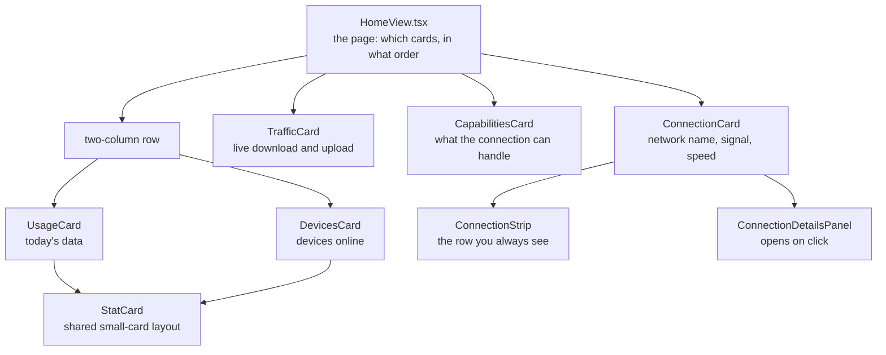

# The big picture

Part 1 of [The Home page, line by line](README.md).

[← Contents](README.md) · [`HomeView.tsx` →](02-home-view.md)

Home is one file that stacks five cards. Each card is its own component in its
own file, and each reads the data it needs for itself.

## What's on the page, top to bottom

| Card | File | Shows | Shown when |
| --- | --- | --- | --- |
| Network | `features/connection/ConnectionCard.tsx` | Network name, signal, link speed, band, security; opens into details | Always |
| Traffic | `features/live-throughput/TrafficCard.tsx` | Live download and upload rates, and a chart of the last minute | Connected |
| Capabilities | `features/capabilities/CapabilitiesCard.tsx` | A tile per activity (streaming, gaming…), coloured by the last speed test | Connected, or earlier results exist |
| Usage | `features/home/components/UsageCard.tsx` | Today's downloaded and uploaded data | Always |
| Devices | `features/home/components/DevicesCard.tsx` | How many devices are online | Always |

## How data reaches the cards

Rove has two halves: the React UI you see, and a Rust backend that measures
the network. The UI asks the backend for data over a bridge, and the backend
sends live updates back. Each card gets its data in one of three ways:

- **Shared app state** that every screen can read, like the current network
  (`useNetwork()`). The app fetches it once, at the top.
- **A data hook** that asks the backend and caches the answer, like
  `useDataUsage()` or `useDevices()`. Two cards asking for the same data share
  one answer.
- **A live store** for things that stream in, like the traffic rate
  (`useLiveThroughput()`) and the speed test (`useSpeedTest()`).

A card never receives its data from Home, except the Connection card, which
Home hands the network info it already has.

[← Contents](README.md) · [`HomeView.tsx` →](02-home-view.md)
