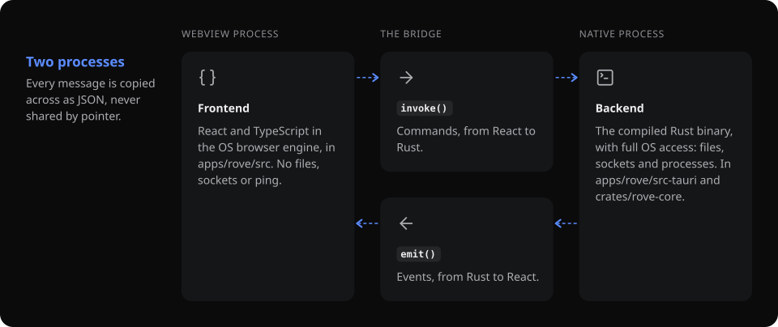

# The shape of a Tauri app, and IPC

Part 1 of [Learning Rust & Tauri through Rove](README.md).

[← Contents](README.md) · [Rust basics: functions, Result, ownership, structs →](02-rust-basics.md)

## 1. The shape of a Tauri app

A Tauri app is two worlds glued together:

  

The frontend is literally a web page. It can't open a socket or read `/sys`.
When it needs something native, it **invokes a command**: it sends a JSON message
across the IPC bridge to a Rust function, which does the real work and returns
JSON. That's the entire mental model. Electron does the same thing but ships a
whole Chromium + Node; Tauri uses the OS's built-in webview and a Rust core, so
the binary is tiny.

Rove splits the Rust side into **two crates** (a "crate" = a Rust compilation
unit / library or binary):

- `crates/rove-core/`: pure logic. The doc comment on line 1 says it:
  *"Pure Rust (no Tauri/GTK dependency) so it compiles and tests anywhere."*
  This is where the actual network measuring lives.
- `src-tauri/`: the "thin Tauri shell." Line 1: *"each command maps 1:1 to a
  service."*

That separation is a deliberate architecture lesson: keep your real logic free
of framework dependencies so you can unit-test it and reason about it in
isolation. The Tauri layer just wires it to the UI.

---

## 2. What IPC actually is

**IPC = Inter-Process Communication.** It's the general term for any mechanism
that lets two *separate running programs* (processes) exchange data. They don't
share memory (each process has its own isolated address space, protected by the
operating system), so they can't just read each other's variables. They have to
pass **messages** through a channel the OS provides: pipes, sockets, shared
memory regions, etc.

### Why Rove needs IPC at all

A Tauri app is not one program; it's (at least) **two processes**:

1. The **webview process**: the OS's browser engine (WebKit on macOS/Linux,
   WebView2/Edge on Windows) running your React UI. It's sandboxed: no file
   access, no sockets, no ability to run a ping.
2. The **Rust process**: your native binary with full OS access.

They are genuinely separate processes with separate memory. So when your React
code needs the public IP, it *cannot* call the Rust function directly: the
function lives in a different process's memory that the webview can't see. The
only way across the boundary is to send a message. That message-passing is the
IPC.

### The channel Tauri uses

Tauri hides the plumbing behind two directions of message flow:

- **Frontend → Backend: commands.** The JS calls
  `invoke("get_public_ip", { args })`. Tauri serializes the call (command name +
  arguments) into JSON, ships it across the IPC channel, and on the Rust side
  deserializes it, finds the matching `#[tauri::command]` function, runs it, then
  serializes the return value back as JSON. `invoke` returns a `Promise`, so from
  JS it feels like a normal async function call; the process boundary and the
  JSON round-trip are invisible.

- **Backend → Frontend: events.** Rust can push messages the other way *without*
  being asked, using `app.emit("event-name", payload)`. The frontend subscribes
  with `listen("event-name", handler)`. Rove uses this for anything streaming
  or unsolicited: `speed-test-progress` (progress bar updates during a speed
  test), `live-throughput` (a sample every second), and `network-changed`
  (fired the instant a cable is pulled). See `src-tauri/src/lib.rs`:
  `run_speed_test` emits progress at line 168-170, and `spawn_throughput_broadcaster`
  emits at line 362.

### Why everything must be JSON-serializable

Because the data is *copied across a process boundary as text*, both sides only
ever exchange things that can be turned into JSON and back. This is exactly why:

- Every type a command returns derives `Serialize` (see `NetworkInfo` in `crates/rove-core/src/connection.rs`).
- Command errors are converted to `String` (`.map_err(|e| e.to_string())`): a
  rich Rust error type can't cross the wire, but a string can.
- The Rust structs use `#[serde(rename_all = "camelCase")]` so the JSON keys
  match what the TypeScript side expects.

You never share a pointer or a live object between the two sides, only values
copied as JSON. Keeping that picture in your head explains most of Tauri's API
design.

### The mental model in one line

> The webview and the Rust core are two isolated processes. IPC is the postal
> service between them: commands are letters you send and wait for a reply to;
> events are letters the backend sends you unprompted. Every letter is written
> in JSON.

---

---

[← Contents](README.md) · [Rust basics: functions, Result, ownership, structs →](02-rust-basics.md)
