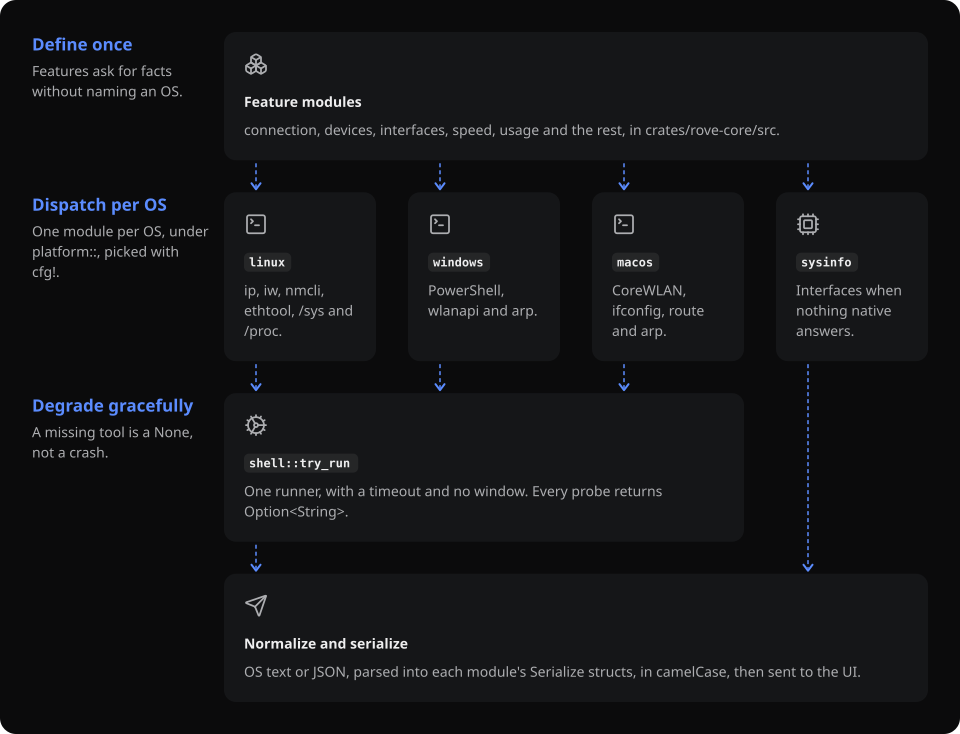

# How Rove Captures Network Data (per OS)

Rove shows you the same facts on every platform (your Wi-Fi signal, the LAN
devices, your gateway, DNS, link speed, live throughput), but **no operating
system exposes these through a single API**. Each OS has its own tools, output
formats, and quirks. This page documents *how* Rove actually gets each piece of
data on Linux, Windows, and macOS, and the design patterns that keep it sane.

All the code lives in `crates/rove-core/`. The OS-specific probes live in one
place, `crates/rove-core/src/platform/`: mostly one module per OS, plus
`windows/` (the native Wi-Fi API), `mac_native.rs` (CoreWLAN) and `app_icon/`.

---

## 1. The core strategy: shell out, then parse

Rove's central technique is **shelling out to the OS's own networking tools and
parsing their text output.** It does *not* re-implement `ip`/`ifconfig`/PowerShell;
it runs them and reads what they print. Two reasons:

- Those tools already have privileged, correct, battle-tested access to the
  kernel's network state. Reimplementing them (raw netlink sockets, WMI COM
  calls, `getifaddrs`) would be far more code and far more fragile.
- It mirrors how the original Electron version of Rove worked, so behaviour
  stays consistent.

The one exception is **byte counters** (data usage + live throughput), which come
from the cross-platform [`sysinfo`](https://docs.rs/sysinfo) crate instead of
shelling out (more on that in §6).

### The command runner

Every shell-out goes through `crates/rove-core/src/utils/shell.rs`:

```rust
pub async fn try_run(command: &str) -> Option<String> {
    try_run_timeout(command, DEFAULT_TIMEOUT).await // 15 s
}
```

Three things to notice, each a deliberate design choice:

- **It returns `Option<String>`, never an error.** A missing tool, a non-zero
  exit, a timeout, or empty output all collapse to `None`. The comment says it:
  *"callers treat missing tools as 'no data'."* This is what makes the fallback
  chains in §3 possible: a failed probe just returns `None` and the caller tries
  the next option.
- **It's `async` with a timeout** (`tokio::time::timeout`, in `capture` in `utils/shell.rs`). A hung
  `nmcli` can't freeze the app; after 15s it's abandoned.
- **It picks the right shell per OS** (`shell` in `utils/shell.rs`): `cmd /C` on Windows, `sh -c`
  everywhere else. On Windows there's a separate `try_run_powershell` because most
  Windows probes are PowerShell, not `cmd`.

There's also a Windows-only detail: `hide_window` sets the `CREATE_NO_WINDOW`
flag (`0x0800_0000`) so spawning `powershell` doesn't flash a black
console window on screen (`CREATE_NO_WINDOW` in `utils/shell.rs`). No-op on Unix.

---

## 2. The safety layer (shell injection)

Because Rove builds shell command strings that sometimes contain values from
the network (interface names, neighbor IPs), it has to guard against injection.
Two gatekeepers in `crates/rove-core/src/utils/net.rs`:

- **`is_shell_safe_ip`** (in `utils/net.rs`): an address is safe to interpolate
  *only if it parses as a real `IpAddr`*, because a parsed address can only
  contain `[0-9a-fA-F:.]`, never a `;`, `|`, `$`, or backtick. It guards the
  reverse-DNS batch (`devices/hostname.rs`) and the Diagnostics ping
  (`diagnostics.rs`), where an IP arrives as a string. The sweep never needs it:
  its IPs are typed `Ipv4Addr` values from the subnet parse.
- **`is_shell_safe_iface`** (in `utils/net.rs`): interface names are bounded to
  ≤40 chars of a safe alphabet. It deliberately *allows spaces* (Windows really
  has interfaces named `"Ethernet 2"` and `"Local Area Connection"`) but rejects
  every genuine metacharacter.

And **`sanitize_display`** (in `utils/net.rs`) strips control characters and
Unicode bidi overrides (and caps the length at 64 characters) from names that come off the network (mDNS TXT records,
reverse DNS) before they're stored or rendered, so a malicious neighbour can't
inject terminal escape sequences or right-to-left overrides into your device
list.

---

## 3. Dispatch and fallback chains

The cross-platform *contract* (which probe to call, in what order) lives in the
feature modules; the OS-specific probes live in `platform/`. `connection.rs`
shows the dispatch pattern. Two flavours:

**Dispatch with `cfg!`**: it expands to a compile-time constant `true` or
`false`, yet every branch still compiles on every OS, and the optimizer drops
the dead ones:

```rust
pub async fn default_gateway() -> Option<String> {
    if cfg!(target_os = "windows") {
        return platform::windows::default_gateway().await;
    }
    if cfg!(target_os = "macos") {
        if let Some((_, Some(gw))) = platform::macos::best_default_route().await {
            return Some(gw);
        }
    }
    // Linux: ip route ...   then fall through to  route -n get default
    if let Some(out) = try_run("ip route show default ... | awk '!/linkdown/ {print $3; exit}'").await {
        ...
    }
    let out = try_run("route -n get default ... | grep gateway ...").await?;
    ...
}
```

Notice the **fallback chain**: on macOS, try the ranked physical route first;
then `ip route` (Linux), and if that returns `None` (iproute2 not installed, or
we're on macOS without a physical route), fall through to `route -n get` (the
BSD/macOS tool). One function, three platforms, graceful degradation.

**Dispatch with a `match` on `std::env::consts::OS`**: a runtime match on a
constant string, so again every arm compiles. `connection_details` (in
`connection.rs`) routes to a different probe per (OS, connection-type) pair:

```rust
match (std::env::consts::OS, connection_type) {
    ("linux",   "wifi") => platform::linux::wifi_details(iface).await,
    ("linux",   _)      => platform::linux::ethernet_details(iface).await,
    ("macos",   "wifi") => platform::macos::wifi_details(iface).await,
    ("macos",   _)      => platform::macos::ethernet_details(iface).await,
    ("windows", "wifi") => platform::windows::wifi_details().await,
    ("windows", _)      => platform::windows::ethernet_details(iface).await,
    _ => ConnectionDetails::default(),
}
```

The ultimate fallback for the interface list is `generic_interface_list()`
(in `platform.rs`), which uses the cross-platform `sysinfo` crate, used when
a native probe fails *and* as the whole implementation on any OS without a
dedicated path.

---

## 4. What gets captured, tool by tool

Here's the master map. Each row is one fact the UI shows; the columns are the
actual command run on each OS.

| Data | Linux | Windows | macOS |
|------|-------|---------|-------|
| **Default gateway** | `ip route show default` | ranked `Get-NetRoute -DestinationPrefix 0.0.0.0/0`, its `.NextHop` | `netstat -rn -f inet`, then `route -n get default` |
| **Default interface** | `ip route show default` (`dev` field) | same ranking, its `.InterfaceAlias` | `netstat -rn -f inet`, then `route -n get default` |
| **DNS servers** | `/etc/resolv.conf` (`nameserver` lines) | `Get-DnsClientServerAddress` | `/etc/resolv.conf` |
| **Interface list** | `ip -j addr` (JSON) + `/sys/class/net/*/speed` | `Get-NetAdapter` + `Get-NetIPAddress` | `sysinfo` + `ifconfig -a` states |
| **Wi‑Fi details** | `nmcli`, then `iw dev link`/`info`, then `iwgetid` | Native Wi-Fi API (`wlanapi.dll`, in-process) | CoreWLAN (in-process) + `system_profiler` |
| **Ethernet details** | `ethtool`, then `/sys/.../speed`, then `nmcli` | `Get-NetAdapter` (LinkSpeed/Duplex) | `ifconfig <if>` (`media:` line) |
| **Link speed** | `/sys/class/net/<if>/speed` | `Get-NetAdapter.LinkSpeed` | CoreWLAN transmit rate (Wi-Fi), `ifconfig` media (Ethernet) |
| **Subnet / CIDR** | `ip -j addr show <if>` | `Get-NetIPAddress` | (subnet module) |
| **Neighbor/ARP table** | `ip neigh show` (has state) | `arp -a` | `arp -an` |
| **Byte counters** | `/sys/class/net/*/statistics` + `sysinfo` | `sysinfo` | `sysinfo` |
| **Timezone offset** | `date +%z` | `[TimeZoneInfo]::Local.GetUtcOffset([DateTime]::Now)` | `date +%z` |
| **Ping** | `ping -c N -i 0.2 -W 1` | `ping -n N -w <ms>` | `ping -c N -i 0.2 -W <ms>` |
| **Public IP** | `https://api.ipify.org` (reqwest) | same | same |

The rest of this section walks the interesting ones.

### Routing: gateway & default interface

The **Windows** approach is subtle and worth calling out (`default_route_field`
in `platform/windows.rs`). The naive way, picking the lowest-metric `0.0.0.0/0`
route, is *wrong*: an unplugged Ethernet adapter can leave a stale metric-0
default route behind. Asking for the effective route (`Find-NetRoute`) is wrong
too, because once a VPN is up that's the tunnel, and discovery would scan the
tunnel's range. So Rove lists every `Get-NetRoute` default route and ranks them:
adapter `Up` only, then hardware NICs above virtual ones, then lowest route plus
interface metric. Gateway and interface come from the same ranking, so they
can't disagree.

Linux reads the routing table directly (`ip route`, skipping `linkdown` routes
and confirming carrier in sysfs). macOS ranks `netstat -rn -f inet` the same way
(`pick_default_route` in `platform/macos.rs`), skipping tunnels and bridges, and
falls back to `route -n get default`.

### Interface list

- **Linux** (`interface_list` in `platform/linux.rs`): `ip -j addr` gives JSON, parsed with serde.
  Link speed comes from reading the file `/sys/class/net/<name>/speed` directly:
  no command needed, `/sys` is a virtual filesystem the kernel exposes.
- **Windows** (`WINDOWS_ADAPTERS` in `platform/windows.rs`): one PowerShell one-liner enumerates
  every adapter and emits pipe-delimited rows (`Name|Status|LinkSpeed|Mac|Virtual|IPv4`).
  There's real domain logic here: it drops all-zero-MAC filter miniports (Npcap,
  WFP), and hides *virtual* adapters (Hyper-V switches, VPN tunnels) unless
  they're actually carrying an IP or serving as the default route, so idle WAN
  miniports and Bluetooth PAN don't clutter the list.
- **macOS**: uses the generic `sysinfo` list, enriched with per-interface up/down
  state parsed from `ifconfig -a` (`interface_info` in `platform/macos.rs`).

### Wi‑Fi details: the messiest per-OS divergence

Each OS reports Wi-Fi completely differently, and Rove normalizes them all into
one `ConnectionDetails` struct:

- **Linux** (`wifi_details` in `platform/linux.rs`) layers *three* tools because no single one
  is complete: `nmcli` (SSID, signal %, frequency, channel, security), then
  `iw dev link`/`info` (signal in dBm, tx bitrate, channel and its width), then
  `iwgetid` as a last-ditch SSID source. Each fills only the gaps the previous
  left (`d.frequency = d.frequency.or(...)`).
- **Windows** (`wifi_details` in `platform/windows.rs`, `platform/windows/wlan.rs`):
  the one place Rove doesn't shell out. `netsh wlan show interfaces` prints its
  labels in the display language ("Kanal" on a German Windows), so a parser keyed
  on English labels reads nothing there. The Native Wi-Fi API gives the same facts
  as numbers and codes: the connection (SSID, signal %, 802.11 generation,
  security), the RSSI and channel, and the access point's entry in the scan list
  (centre frequency, beacon). Rove labels the codes itself, "802.11ax" and
  "WPA3-Personal" as the other platforms say them. The saved passphrase comes
  from the profile's XML (`WlanGetProfile`), in plain text only to an elevated
  administrator.
  Windows reports no channel width, so Rove reads the one the access point
  advertises from its beacon's HT, VHT, HE and EHT Operation elements
  (`platform/windows/beacon.rs`). That's the access point's width, not the one
  the link agreed: an 80 MHz-only adapter on a 160 MHz access point reads 160.
  The link's 802.11 generation narrows it where it can.
- **macOS** (`wifi_details` in `platform/macos.rs`, `platform/mac_native.rs`): Apple gutted the
  private `airport -I` tool on macOS 14.4+ (it prints only a deprecation notice)
  and every shell tool now returns `<redacted>` for the SSID. So Rove reads Wi-Fi
  *in-process* via **CoreWLAN**: the SSID (gated behind Location Services, which
  Rove requests once at startup through CoreLocation) and the transmit rate.
  CoreWLAN is the only remaining source of Wi-Fi link speed. `system_profiler`
  fills in RSSI/channel and its width/security (cached off the hot path since it takes seconds),
  with `networksetup` kept only as a legacy SSID fallback.

A shared post-step, `finalize_wifi` (in `platform.rs`), converts a dBm RSSI
into a 0–100% bar whenever the OS only gave dBm, so the signal meter looks the
same everywhere.

---

## 5. LAN device discovery (the ARP table trick)

> This is a summary. For the full pipeline (TCP/mDNS probing, OUI vendor lookup,
> reverse-DNS batching, and the weighted-vote device classifier), see the
> dedicated page: [How Rove Discovers & Identifies LAN Devices](device-discovery.md).

The device scanner (`crates/rove-core/src/devices.rs`) is a small pipeline,
and it's a nice piece of network engineering. The **ground truth for "who's on my
LAN" is the kernel's neighbor table** (the ARP cache on IPv4): the map from IP
to MAC the kernel has already resolved. Rove reads it via `ip neigh show` on
Linux (which includes a reachability state), `arp -an` on macOS or `arp -a` on
Windows (`neighbor_table` in
`platform.rs`).

But the ARP cache only holds hosts the machine has *recently talked to*: idle
devices won't be there. So before reading it, Rove **actively wakes every host
in the subnet** (`devices/sweep.rs`):

```rust
// ping every address in the /24..30, 64 at a time
futures_util::stream::iter(hosts)
    .map(|ip| async move {
        let cmd = crate::platform::ping_command(&ip.to_string(), 1, PING_WAIT_MS);
        let replied = crate::utils::shell::try_run_timeout(&cmd, PING_PROCESS_TIMEOUT).await.is_some();
        replied.then_some(ip)
    })
    .buffer_unordered(CONCURRENT_PROBES) // 64 concurrent
    .filter_map(|replied| async move { replied })
    .collect::<HashSet<Ipv4Addr>>()
    .await
```

The clever part (the `//!` header of `sweep.rs`): **discovery doesn't need the
ping to succeed.** (The replies are kept only as a liveness signal.) The point is that sending *any* packet forces the kernel to do an ARP
exchange to find the target's MAC, which populates the neighbor table *even for
hosts that silently drop the ping*. The ping is bait; the ARP entry is the catch.
A TCP port probe runs alongside to reach ICMP-filtering hosts, plus two passive
listeners (**mDNS** and **SSDP/UPnP**) that catch devices announcing their own
friendly names and models.

Everything then gets enriched: vendor from the MAC's OUI prefix; hostname from
whichever source is friendliest (mDNS, then SSDP, NetBIOS, DHCP and reverse DNS,
with a synthetic label as a last resort); a
hardware model from mDNS/SSDP/SNMP; an OS family from a passive DHCP
fingerprint; and a device `kind` from a weighted-vote classifier that also folds
in HTTP-banner hints. The local machine is added manually because it never
appears in its own neighbor table (`add_self_if_missing` in `devices.rs`),
then the list is deduped by MAC. The full pipeline (SSDP, HTTP banners,
NetBIOS, SNMP, DHCP, and the classifier) is covered in the
[device-discovery page](device-discovery.md).

---

## 6. Byte counters: data usage & live throughput

These two are the exception to "shell out": they read kernel byte counters via
the `sysinfo` crate, which is cross-platform, so there's very little per-OS code.

- **Live throughput** (`crates/rove-core/src/live_throughput.rs`): a stateful
  1 Hz sampler. `sysinfo`'s `received()`/`transmitted()` return the *delta* since
  the last refresh, so throughput is `bytes * 8 / 1e6 / elapsed_secs` = Mbps,
  then exponentially smoothed (`SMOOTH_ALPHA = 0.35`) so the chart isn't jagged.
  It sums only physical interfaces (skipping `veth`/`docker`/`tun`/… via
  `is_virtual_interface`).
- **Data usage** (`crates/rove-core/src/usage.rs`): accumulates those
  deltas into daily buckets. It uses `saturating_sub` on the counters so a counter
  *reset* (reboot, driver reload) credits zero rather than dumping a phantom
  multi-GB spike.

The one per-OS wrinkle is the "since-boot total": on **Linux**, Rove prefers
reading `/sys/class/net/*/statistics/{rx,tx}_bytes` directly
(`boot_totals` in `platform/linux.rs`) because `/sys` is authoritative; on
Windows/macOS it falls back to summing `sysinfo`'s totals.

---

## 7. Diagnostics & ping

`crates/rove-core/src/diagnostics.rs` measures gateway health by pinging it 10
times and parsing the RTT out of each reply line with a regex
(`time=12.3 ms`). From those samples it computes average latency, **jitter**
(mean absolute difference between consecutive RTTs), and **packet loss**
(replies received vs. probes sent). The `ping` flags differ per OS, abstracted
behind `ping_command` (in `platform.rs`): Windows uses `-n <count> -w <ms>`,
Linux `-c <count> -i 0.2 -W 1`, macOS `-W <ms>` (its `-W` takes milliseconds).

---

## 8. The design in one picture

<div align="center">
  , with sysinfo as the fallback; everything is normalized and serialized to the UI" />
</div>

**The whole philosophy:** define the facts once as OS-agnostic functions, dispatch
to per-OS probes that shell out to each platform's native tools, treat every probe
as fallible (`Option`), chain fallbacks, and normalize everything into each module's
`Serialize` structs that serialize across the IPC bridge to the UI. Adding support
for a new OS means adding one file under `platform/` and a `match` arm: the
feature modules and the UI don't change.
