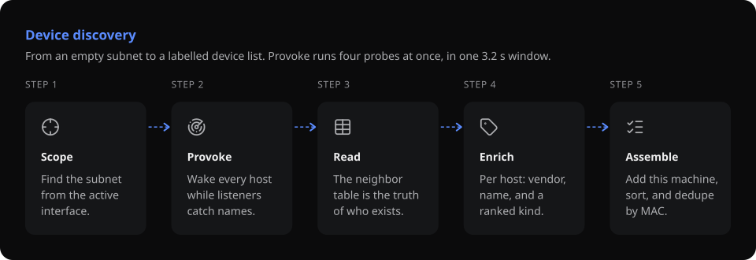

# What Rove Measures, and How

Rove reads the operating system's own tools and counters wherever it can. This
page says where each
reading comes from, what it can miss, and which tool answers it on each OS. The capture layer behind it (running the
tools, parsing them, the fallbacks) is in
[How Rove Captures Network Data](networking/data-capture.md).

## Feature by feature

**Connection card / network info.** The kernel routing table is the source of
truth: `ip route show default` names the interface your traffic really uses
(so LAN↔Wi-Fi switches are always right). Then per-medium tools fill in the
detail: `iw`/`nmcli` for SSID, band, channel and signal; `ethtool`/sysfs for
link speed and duplex. DNS comes from `resolv.conf`.

**Live traffic.** A 1 Hz sampler reads the kernel's cumulative per-interface
byte counters (via `sysinfo`), converts deltas to Mbps, smooths them with an
exponential moving average, and emits an event. Virtual interfaces (docker,
veth, vpn…) are excluded.

**Devices.** A five-stage pipeline (`crates/rove-core/src/devices/`), walked
in full in [How Rove Discovers & Identifies LAN Devices](networking/device-discovery.md):

  

1. *Scope*: take the active interface's subnet (e.g. `192.168.1.0/24`).
2. *Provoke*: for ~3 s, ping every host and try a TCP connect to a dozen
   tell-tale ports (80, 443, 9100, 8009, 62078, …), while listening for mDNS
   (`_googlecast`, `_ipp`, `_hap`, …) and SSDP/UPnP announcements.

   The replies matter less than the ARP lookup each probe forces: a device
   enters the kernel neighbor table even if it drops ping and refuses every
   port. Ports that accept double as type hints. Active probing runs on
   /24–/30 subnets only.
3. *Read*: `ip neigh` (or `arp -a`) is the ground truth of who exists.
4. *Enrich & classify*: each host gets a vendor (MAC OUI table, randomized
   MACs flagged) and a hostname (reverse DNS, mDNS, HTTP banner, NetBIOS; junk
   names filtered).

   Its kind is a best-effort, trust-weighted vote over mDNS services and
   models, SSDP descriptions, open ports, and hostname and vendor patterns. The
   router also gets an SNMP `sysDescr` read, and DHCP fingerprints count when
   the passive listener can bind :67.
5. *Assemble*: add this machine, sort gateway → self → by address, dedupe by
   MAC.

A device that blocks every probe still appears, just unnamed. What gets missed:

- a device that's asleep and doesn't answer ARP;
- a client on a guest network, behind AP isolation, or on another VLAN;
- on subnets larger than /24, anything that neither announces itself nor
  already sits in the neighbor table.

The router's admin page stays authoritative.

**Speed test.** Saturates the link for ~6 s per direction: parallel HTTPS
streams from public test endpoints (download) and random-payload POSTs
(upload), then 10 pings to 1.1.1.1 for latency, jitter and loss.

Progress streams as events, and a cancel command aborts between and within
phases (streams poll a shared flag). Results feed the capability ratings (can
this connection do 4K, cloud gaming…) against per-activity thresholds.

Fair warning: at multi-gigabit rates one test moves 1–2 GB. That's inherent to
how throughput measurement works.

**Data usage.** Every 30 s the backend adds counter deltas to per-day buckets
in the app-data dir, so totals survive restarts. Today's total also counts
what's moved since the last save, read fresh each time the view asks, so it
climbs every couple of seconds instead of in 30 s steps. The kernel's counters reset at
boot, which the delta logic handles. The "since boot" totals in the UI are read
straight from `/sys/class/net/*/statistics` at query time: kernel truth, no
bookkeeping.

**Diagnostics.** Pings your default gateway (latency, jitter, packet loss) and
lists the DNS servers in use.

## Per OS

All services run on Linux, macOS and Windows. Each looks for the native tool
for the job and degrades gracefully (a missing value shows as a short bar):

| | Linux | macOS | Windows |
|---|---|---|---|
| Default route / interface | `ip route` | `route -n get` | `Get-NetRoute` |
| Wi-Fi details | `nmcli`, `iw` | CoreWLAN, `system_profiler` | Native Wi-Fi API |
| Link speed | `ethtool`, sysfs | CoreWLAN (Wi-Fi) | `Get-NetAdapter` |
| DNS servers | `resolv.conf` | `resolv.conf` | `Get-DnsClientServerAddress` |
| Neighbor table | `ip neigh` | `arp -a` | `arp -a` |
| Reverse hostnames | `getent` | `dscacheutil` | `System.Net.Dns` |
| Interface state | sysfs | `ifconfig` | `Get-NetAdapter` |
| App icons | `.desktop` entries, icon theme | AppKit | Shell (`.exe` icon) |
| mDNS, sweep, speed test, throughput, usage | pure Rust everywhere | ✓ | ✓ |

Platform branches are runtime `cfg!()` checks, so they typecheck on every OS.
The in-process OS APIs (CoreWLAN, the Windows Native Wi-Fi API, app icons)
compile only on their own OS; CI (`.github/workflows/build.yml`) builds all three bundles for
each release tag. The
instant network-change monitor (`ip monitor route`) is Linux-only; macOS and
Windows fall back to the 15 s poll.

On macOS 14.4+ the private `airport` tool was gutted (it now only prints a
deprecation notice), so Rove reads Wi-Fi in-process via CoreWLAN, including the
link speed (transmit rate), which the shell tools no longer expose. The SSID
sits behind Location Services, so Rove asks for that permission once at
startup; without it the network name shows as missing while everything else
still resolves.
