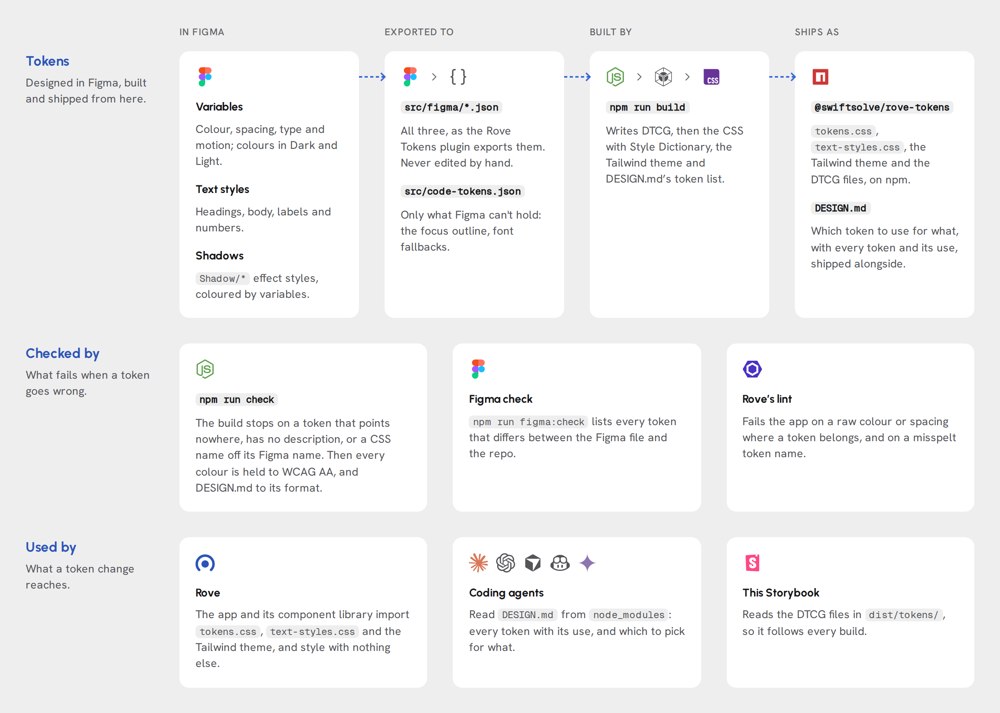

<div align="center">


# Rove Tokens

The design tokens behind Rove, designed in Figma<br>
and shipped as CSS, a Tailwind theme and DTCG.

**Dark and Light themes, WCAG 2.2 AA in both, and a [`DESIGN.md`](DESIGN.md) that tells people and coding agents which token to use for what.**

[](https://www.npmjs.com/package/@swiftsolve/rove-tokens)
[](https://github.com/swiftsolve/rove-tokens/actions/workflows/publish.yml)
[](https://www.designtokens.org/tr/2025.10/format/)
[](docs/rationale.md)

**[Figma file](https://www.figma.com/design/NoICIoyhWNOya9tOnNfEhH/Rove-Design-System)** &nbsp;·&nbsp;
**[Tokens Storybook](https://nabilr.com/rove/storybook/tokens/)** &nbsp;·&nbsp;
**[Components Storybook](https://nabilr.com/rove/storybook/)** &nbsp;·&nbsp;
**[DESIGN.md](DESIGN.md)** &nbsp;·&nbsp;
**[Rationale](docs/rationale.md)**

</div>

---

## Overview

Rove is a desktop network monitor, and every colour, space, type style, shadow and motion curve in its UI comes from this package. The tokens are designed in the Rove Design System in Figma, exported into this repo by a Figma plugin, and built into CSS variables, a Tailwind v4 theme and [Design Tokens Format](https://www.designtokens.org/tr/2025.10/format/) (DTCG) files.

They flow one way. Figma is the source of truth and git is the record: nothing here writes back to Figma, and a check lists anything in the repo that no longer matches the file.

**What sets it apart:**

- **One source, four outputs.** `tokens.css`, a class per text style, a Tailwind theme with Tailwind's own scales cleared, and DTCG for other tools, all from one Figma export.
- **Accessible by construction.** Every text and graphic colour is measured against what it sits on, in both themes, and the build fails below WCAG 2.2 AA.
- **Written for agents too.** [`DESIGN.md`](DESIGN.md) ships in the package, in the [DESIGN.md format](https://github.com/google-labs-code/design.md): every token with its value and its use.
- **Checked against Figma.** `npm run figma:check` compares the repo with the Figma file, token by token, and reports every difference.

## Getting started

Install the package:

```bash
npm install @swiftsolve/rove-tokens
```

Import the tokens, and the Tailwind theme if you use Tailwind v4:

```css
@import '@swiftsolve/rove-tokens/tokens.css';
@import '@swiftsolve/rove-tokens/text-styles.css'; /* optional: a class per text style */
@import '@swiftsolve/rove-tokens/tailwind-theme.css'; /* optional: Tailwind v4 */
```

Dark is the default, on `:root`. Add `theme-light` to the root element for Light:

```html
<html class="theme-light"></html>
```

Then style with the tokens, never raw values:

```css
.card {
  padding: var(--card-padding);
  background: var(--bg-surface);
  border-radius: var(--radius-lg);
  box-shadow: var(--shadow-panel);
}
```

```html
<p class="type-body text-secondary p-12">Signal is strong.</p>
```

[Using the tokens](docs/using-the-tokens.md) covers the naming, the text style variables, the Tailwind mapping and the DTCG files.

## What's in the package

| Import | What |
| --- | --- |
| `@swiftsolve/rove-tokens/tokens.css` | Every token as a CSS variable: Dark on `:root`, Light on `:root.theme-light`. |
| `@swiftsolve/rove-tokens/text-styles.css` | A `.type-<style>` class per Figma text style, in `@layer components`. |
| `@swiftsolve/rove-tokens/tailwind-theme.css` | A Tailwind v4 theme made of the tokens and nothing else. |
| `@swiftsolve/rove-tokens/tokens/*` | The DTCG files, for Style Dictionary, Tokens Studio and similar tools. |
| `DESIGN.md` | Which token to use for what, with every token's value and use. Agents read it from `node_modules/@swiftsolve/rove-tokens/DESIGN.md`. |

## Principles

- **Figma is the source of truth.** A token changes in Figma first, then is exported and built. Nothing in `dist/` or `src/figma/` is edited by hand.
- **A scale, then a role.** `spacing/12` is a step on a scale; `card/padding` names a job and points at a step. Use the job when there is one.
- **Every colour lives once.** The Palette holds each shade, and the Color tokens point at it by role, so a theme is a different set of pointers.
- **Readable in both themes.** Text clears 4.5:1 and icons, bars and dots 3:1, in Dark and Light. [Rationale](docs/rationale.md) has the close calls, and the [decision records](docs/adr/) say why the system is shaped this way.

## How it works

<picture>
  <source media="(prefers-color-scheme: dark)" srcset="docs/assets/how-it-works-dark.png">
  
</picture>

### Tokens

The Rove Tokens plugin exports the file's variables, text styles and `Shadow/*` effect styles to `src/figma/`. `npm run build` turns them into DTCG, then into CSS with [Style Dictionary](https://styledictionary.com/), the Tailwind theme and `DESIGN.md`'s token list. A release puts them on npm.

### Checked by

`npm run check` builds, typechecks and lints, then holds every colour to WCAG AA and `DESIGN.md` to its format. `npm run figma:check` compares the repo with Figma. In Rove, a lint fails a raw colour or spacing where a token belongs.

### Used by

Rove and its component library, the coding agents that work on them, and the [Tokens Storybook](https://nabilr.com/rove/storybook/tokens/), which reads the DTCG files and follows every build.

## Project structure

| Directory | Purpose |
| --- | --- |
| `src/` | The Figma export (`src/figma/`) and what Figma can't hold (`code-tokens.json`). |
| `scripts/` | The build, the checks and the Figma scripts, in TypeScript that Node runs directly. |
| `figma-plugin/` | Rove Tokens, the Figma plugin that exports the file and checks it against the repo. |
| `stories/`, `.storybook/` | The Tokens Storybook. |
| `docs/` | Usage, rationale and decision records. |
| `dist/` | The built package. Generated, never edited. |

## Contributing

Every token change starts in Figma. [CONTRIBUTING.md](CONTRIBUTING.md) walks through exporting, checking and releasing, lists every script, and says what each file does. Coding agents follow the same steps in the [`update-tokens` skill](.claude/skills/update-tokens/SKILL.md), under the rules in [AGENTS.md](AGENTS.md).

To work on the repo:

```bash
nvm use 24
npm install
npm run check
```

`npm install` builds the tokens and turns on the git hooks. `npm run storybook` opens the Tokens Storybook on <http://localhost:6007>.

## License

UNLICENSED. All rights reserved.
